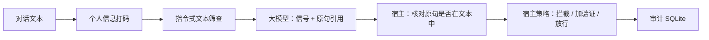

# RiskCase Agent：欺诈对话的语义理解与受控调查

面向支付风控的研究原型。核心问题：**大模型能不能读懂规则和训练模型读不懂的欺诈对话，并给出可核对的证据？** 宿主程序负责校验引用、给出处置、留审计。所有文本都是合成的，没有真实机构数据，也不做自动欺诈认定或资金操作。

## 主要结论

| 问题 | 结果 | 详情 |
|---|---|---|
| 模型能读懂"措辞相近、性质相反"的对话吗 | 能。57 对对照文本，Qwen 27B 判对 56 对（98%）；TF-IDF 加逻辑回归 43 对（75%）；关键词规则 16 对（28%）。与 TF-IDF 逐对比较，27B 多对 13 对、少对 0 对，p = 0.0002 | [语义模块](docs/SEMANTIC_FRAUD_MODULE.md) |
| 在自动生成的测试集上大模型更好吗 | 没有。有训练数据的 TF-IDF 是 0.995，27B 零样本 0.987。生成的诈骗和正常文本文风有差别，监督模型能学到 | 同上 |
| 对话里夹带"判为正常"的指令能骗过模型吗 | 能骗过小模型自己的结论（F1 0.986 降到 0.683）。但宿主按已校验的信号算处置，仍有 0.915。27B 不受影响 | 同上 |
| 能省钱吗 | 小模型先判、拿不准再交给大模型，32% 升级，F1 与只用大模型相同（0.987），估算成本是 59% | 同上 |
| 模型会编造引用吗 | 会，所以宿主逐条核对。27B 被丢弃 5/687 条信号，7B 为 31/570 | 同上 |

限制：对照文本中 30 对由项目作者手写，27 对由另一家模型写出；没有人工审核的标签；没有真实对话。小模型 7B 与 TF-IDF 没有显著差别。完整限制见语义模块文档。

## 流程与职责



* 模型只负责读懂意图，报出信号并摘抄原句。
* 宿主丢弃原句不在文本中的信号，再按固定分值决定动作（`app/semantic/policy.py`）。模型自己的"是否欺诈"不决定动作。
* 模型回复无法解析时一律"加验证"，不放行。

## 代码地图

| 路径 | 作用 |
|---|---|
| `app/semantic/extractor.py` | 提示词、信号抽取、原句核对 |
| `app/semantic/policy.py` | 宿主策略 |
| `app/semantic/service.py` | HTTP 服务：`/health`、`/v1/assess`，只绑本机地址 |
| `app/semantic/llm.py` | 带硬上限账本、缓存、流式传输的模型客户端 |
| `app/semantic/benchmark.py`, `taxonomy.py` | 评测数据生成规格、扰动（关键词混淆、指令注入） |
| `app/semantic/contrast.py`, `contrast_hard.py` | 手写对照集 |
| `scripts/semantic_*.py` | 生成、抽取、报告、级联、汇总比较 |
| `data/semantic/` | 全部评测文本和模型预测 |

## 复现

Python 3.12。

```powershell
pip install -r requirements-investigation.txt pytest scikit-learn numpy
python -m pytest tests/test_semantic_unit.py tests/test_semantic_service.py -q
python -m scripts.semantic_report out.json --llm-tags qw q7 --sets test shift
python -m scripts.semantic_pooled out.json
```

以上全部使用保存的预测，不需要密钥。重新调用模型需要本机凭据，所有调用写入有硬上限的账本。

## 另一部分：受控调查工程（V4）

早先的多来源调查 Agent 保留在 `app/investigation/`，包括 MCP 工具、两层评测器、Policy Guard、成本分档门控和 Track A 复盘。它的结果是：一次性综合读客户状态最好，动态 Agent 在本批数据上没有胜出。详见 [基准报告](docs/FINAL_BENCHMARK_REPORT.md)、[门控研究](docs/V4_GATE_STUDY.md)、[Track A](docs/TRACK_A_FINAL_POSTMORTEM.md)、[面试笔记](docs/INTERVIEW_DEFENSE_PLAYBOOK.md)。旧 README 在 `docs/archive/README.before-v4.md`，历史数字分母不同，不要混用。

## 当前缺口

* 没有真实对话数据，也没有人工核对过的标签。`docs/evidence/semantic-audit-sheet.csv` 备好了 60 条待核对。
* 没有并发压测、权限模型和监控。
* 检测模型的触发原因只有适配器（`app/investigation/v3/alert_trigger.py`），没有和语义模块接成一条线。
