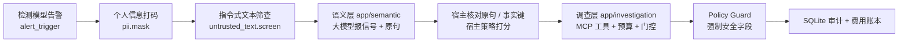

# RiskCase Agent：欺诈对话的语义理解与受控调查

面向支付风控的研究原型。核心问题：**大模型能不能读懂规则和训练模型读不懂的欺诈对话，并给出可核对的证据；宿主程序又怎样把这些证据变成受控的处置和调查。** 所有文本和调查记录都是合成的，没有真实机构数据，也不做自动欺诈认定或资金操作。

本仓库的每个数字都能在 `docs/evidence/` 找到来源文件。没达到预期的结果也写在这里。

## 目录

1. [系统总览与流程](#1-系统总览与流程)
2. [三层语义证据](#2-三层语义证据)
3. [调查 Agent 的 V5 基准](#3-调查-agent-的-v5-基准)
4. [Track A：行为向量复盘](#4-track-a行为向量复盘)
5. [工程与复现](#5-工程与复现)

## 1. 系统总览与流程



职责分工：

* 模型只读文本，报出信号并摘抄原句，不决定处置。
* 宿主丢弃原句不在文本中的信号，再按固定分值给出"拦截 / 加验证 / 放行"（`app/semantic/policy.py`）。解析失败一律"加验证"。
* 调查层把多个来源（客户陈述、授权记录、设备、商户）按预算和门控读进来，由 Policy Guard 强制 `disposition_executed=False`、`human_review_required=True`，并按信号补上必需的干预措施。
* 每次模型调用走带硬上限的费用账本。

| 路径 | 作用 |
|---|---|
| `app/semantic/` | 信号抽取、跨来源核对、宿主策略、服务、评测规格 |
| `app/investigation/` | MCP 调查、门控、Policy Guard、B5 语义引导流程 |
| `app/evaluation/` | V4/V5 评测运行器和评分 |
| `data/semantic/` | 评测文本、模型预测 |
| `docs/evidence/` | 每个数字对应的结果文件 |

## 2. 三层语义证据

语义模块分三层，每层回答一个不同的问题。

### 2.1 措辞相近、性质相反的对照文本（99 对）

| 方法 | 判对对数（共 99） |
|---|---:|
| Qwen 27B | 94（95%） |
| TF-IDF + 逻辑回归 | 80（81%） |
| 关键词规则 | 32（32%） |

27B 与 TF-IDF 逐对比较：多对 15 对，少对 1 对，p = 0.0005。30 对由作者手写，69 对由另一家模型（DeepSeek）生成；只看后者，差距缩小为 64 对比 60 对。详见 [语义模块](docs/SEMANTIC_FRAUD_MODULE.md)。

### 2.2 自动生成的测试集：大模型没有胜出

有训练数据的 TF-IDF 的 F1 为 0.995，27B 零样本为 0.987。生成的诈骗与正常文本文风有差别，监督模型能学到。所以大模型的优势只在对照文本上成立，不能表述为"整体更强"。

### 2.3 跨来源核对（V5 新增）

任务：一段陈述是否与另一来源的结构化事实矛盾（`app/semantic/cross_context.py`）。四类：不在场证明与遥测冲突、被胁迫转账与真实转账、范围与引述否认、多轮自相矛盾。模型必须同时给出原句和事实键，宿主两边都核对。

40 对未见测试集（每对两个文本，两个都判对才算对）：

| 方法 | 整对判对（共 40） |
|---|---:|
| 规则 | 0 |
| TF-IDF（用开发集 40 对训练） | 17 |
| 7B（双重核对） | 7 |
| 27B（双重核对） | 23 |
| 7B 先判、27B 复核 | 19 |

27B 对 TF-IDF：多对 13 对，少对 7 对，p = 0.26，**差距没有统计显著性**。27B 在"不在场证明"一类 9/10 对，TF-IDF 0/10；在"范围与引述否认"一类只有 1/10。27B 的误报率为 0.33。V5 方案预期 TF-IDF 约 50%、大模型 90% 以上，这个预期**没有达到**。题目由大模型生成，标签有噪声，限制见文档第 6 节。

### 2.4 注入和成本

* 对话夹带"判为正常"的指令：7B 自己的结论 F1 从 0.986 降到 0.683，宿主按已核对信号算的处置仍有 0.915。27B 不受影响。
* 7B 先判、拿不准再交 27B：32% 升级，F1 与只用 27B 相同（0.987），估算成本为 59%。
* 引用核对有用：27B 被丢弃 5/687 条信号，7B 为 31/570。

## 3. 调查 Agent 的 V5 基准

12 个未参与调优的案例，每案 3 个阶段，共 36 个阶段。通过标准 Tier 1 = 状态正确且处置安全。"护栏后"指经过 Policy Guard 的结果。

| 条件 | 状态正确 | Tier 1 原始 | Tier 1 护栏后 | 每次运行证据额度 | 每次运行模型费用 |
|---|---:|---:|---:|---:|---:|
| B0 规则全量读取（无模型） | 27 | 24 | 24 | 4.33 | 0 |
| B1S 一次性综合 | 35 | 7 | 26 | 5.17 | 0.103 |
| B4N 固定流程 + 模型 | 32 | 5 | 32 | 4.33 | 0.098 |
| B2V4 动态 Agent + 门控 | 31 | 8 | 30 | 4.67 | 0.172 |
| B5 语义引导流程 | 30 | 23 | 30 | 4.33 | 0.036 |

要点：

* **护栏贡献大。** B1S 的 Tier 1 从 7 升到 26，B4N 从 5 升到 32：模型自己的处置字段不可靠，Guard 补上安全字段后才通过。
* **B5 没有达到目标。** 方案要求 Tier 1 ≥ 34/36，B5 为 30/36。它有 26 个阶段走了免费的规则路径，模型费用最低（0.036 元/次）；但 B4N 的 32 更高，代价是 2.7 倍的模型费用。B5 的规则没有在看到留出结果后调整。
* 动态 Agent 没有胜出：B2V4 的 30 低于 B4N 的 32，费用更高。

### 来源门控研究

用主来源 2、佐证来源 2、回退来源 6 额度的成本阶梯，比较三种策略（[详情](docs/V4_GATE_STUDY.md)）：

| 策略 | Tier 1 护栏后 | 每次运行额度 | 相对 S1 节省 | 真实反馈驱动率 | 过早回退读取 | 被拦截 |
|---|---:|---:|---:|---:|---:|---:|
| S1 全部读取 | 29/36 | 9.67 | 0 | 无决策 | 5/12 | 0 |
| S2 Agent，无门控 | 23/36 | 9.17 | 5% | 0.29 | 5/13 | 0 |
| S3 Agent + 前置条件门控 | 17/36 | 5.83 | 40% | 0.50 | 0/7 | 17 |

门控做到了它的设计目标：过早读取降到 0，额度节省 40%。**代价是准确度**：S3 在 5 个案例里只读了 2 额度的主来源，后两个阶段丢失，Tier 1 从 29 降到 17。门控版本不能直接拿去用。

其他限制：记录是模拟的；"未解决"由规则读取器判定；每个条件 12 个案例各跑一次，没有置信区间。详见 [最终基准报告](docs/FINAL_BENCHMARK_REPORT.md)。

## 4. Track A：行为向量复盘

Track A 是早先用行为序列的向量做欺诈检测的实验，已停止。V5 补做两件事（[复盘](docs/TRACK_A_FINAL_POSTMORTEM.md)）：

* **前缀消融**：模型向量两两平均余弦相似度 0.690，去掉前缀后 0.608 / 0.595，有效秩从 95.2 升到 119.1 / 120.6（高斯噪声为 784）。前缀只是次要因素，向量挤在一个窄锥里主要不是它造成的。
* **一次性留出评测**（18 个正例，20,673 行）。开发集结果重放与保存值完全一致。

| 方法 | 留出 AP（95% 聚类区间） |
|---|---:|
| 普通特征模型 | 0.435 [0.21, 0.65] |
| 领域特征 | 0.399 |
| 随机 128 维 | 0.391 |
| Qwen 向量 128 维 | 0.262 [0.10, 0.51] |
| TF-IDF + LR | 0.200 |

正例只有 18 个，区间大幅重叠，只能说向量没有优于普通特征，不能说谁更差。

## 5. 工程与复现

Python 3.12。

```powershell
python -m venv .venv
.venv\Scripts\pip install -r requirements-investigation.txt pytest scikit-learn numpy
$env:PYTHONPATH="."
.venv\Scripts\python.exe -m pytest tests/test_semantic_unit.py tests/test_semantic_service.py tests/test_cross_context.py tests/test_b5_workflow.py tests/test_precondition_gate.py tests/test_policy_guard.py -q
```

重算报告（用保存的预测，不需要密钥）：

```powershell
python -m scripts.semantic_report out.json --llm-tags qw q7 --sets test shift
python -m scripts.semantic_pooled out.json
python -m scripts.v5_pooled_report <study_dir> out.json
python -m scripts.v5_u3_report <study_dir> out.json
```

重新调用模型需要本机凭据，所有调用写入有硬上限的账本，凭据不进仓库。

* 数据：`data/semantic/`（对照集、跨来源 dev 40 对和 test 40 对、预测在 `preds/`）。
* 冻结：`docs/evidence/heldout-freeze.json`。Policy Guard 在冻结之后有改动，原因和影响见基准报告。
* 审计：每次运行落 SQLite；`runs/` 不入库。
* 并行付费运行需要各自独立的账本副本，否则基线校验会失败。

### 限制

* 没有真实对话和真实调查记录；标签由模型生成，没有人工复核。`docs/evidence/semantic-audit-sheet.csv` 备好了 60 条待核对。
* 评测集规模小（12 个案例、40 对），多处没有统计显著性，文中已逐项标出。
* 没有并发压测、权限模型和监控。
* 旧 README 在 `docs/archive/README.before-v4.md`，历史数字的分母不同，不要混用。

### 其他文档

[语义模块](docs/SEMANTIC_FRAUD_MODULE.md) · [基准报告](docs/FINAL_BENCHMARK_REPORT.md) · [门控研究](docs/V4_GATE_STUDY.md) · [Track A 复盘](docs/TRACK_A_FINAL_POSTMORTEM.md) · [面试笔记](docs/INTERVIEW_DEFENSE_PLAYBOOK.md)（含与 FinResearch Agent 的对比）
