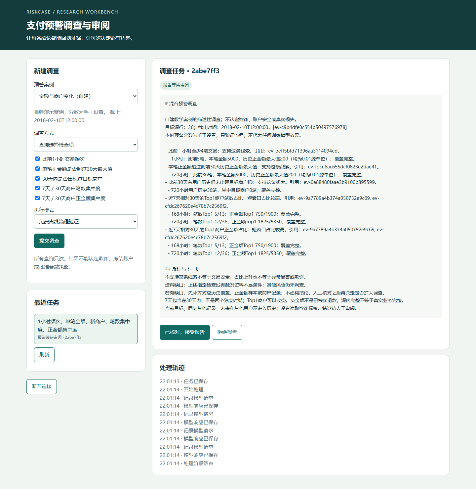
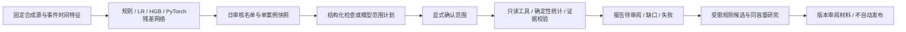

# RiskCase Agent

**当前主线（2026-10-30）**：原始支付案卷调查与人工审阅。模型读取清算、支付映射、退款台账及适用规程，宿主管理MCP、Skill、预算、恢复与完整引用，人工确认语义后批准模拟工单。[第五阶段](docs/STAGE5_REPORT.md)完成限定演示验收：同六个已观察合成案例上，全部资料与动态取证两组各6/6通过；动态少读50%原件，但费用约2.89倍，因此小案卷默认简单路径。**不是独立泛化测试或生产收益证明。**

从[新案卷使用入口](docs/RAW_DOSSIER_QUICKSTART.md)、[可携带真实证据包](docs/evidence/dossier-v4/README.md)、[面试手册](docs/AGENT_INTERVIEW_PLAYBOOK.md)进入。准备自己的合成案卷不调用模型；执行需要显式付费开关和费用上限。已有真实结果可免费审阅。第五阶段三批估算2.905288元，项目累计13.048320元；初次失败、修复回归与原始请求/响应均保留。

**第四阶段历史记录（2026-10-29）**：按用户确认的[四阶段路线](docs/AGENT_ROADMAP.md)，已完成 MCP/工具治理、Skill/Harness、RAG/经验发布及[冻结评测与面试交付](docs/STAGE4_REPORT.md)。工程能力有可复核实现，**真实模型收益尚未证明**：本批基础Agent1/3、原完整组合0/3；发现并修复宿主完成条件缺陷，但未另付费测量新版质量。请从[面试手册](docs/AGENT_INTERVIEW_PLAYBOOK.md)与[能力边界](docs/AGENT_CAPABILITY_MATRIX.md)进入，勿把代码控制或旧响应重放当新模型成绩。

旧路径一键免费演示：`scripts/start_interview_demo.ps1`。第四阶段当时全仓836项通过；60个内部场景×5条代码路径通过，另有修复前后各15次真实MCP抽验。第四阶段67次实际模型请求估算1.169448元，项目累计估算10.143032元。原始失败、冻结源码、修复版本与费用回执分别保存。

安装 `requirements-investigation.txt` 后启动原工作台，点击“进入 Skill 与 Harness 多来源调查（免费演示）”即可使用新闭环；沿用本地访问令牌。页面展示调查进度、证据和已加载技能，保存草稿后再批准并提交至本地模拟队列，修改会使旧批准失效。命令行可用 `python -m app.cli.harness_demo demo --directory runs/my-harness-demo --case 4`，其中审批明确由演示脚本模拟。

同一页面的“过程知识与经验版本”可验证错误方法被拒绝、正确候选经16个任务决策案例回归后审阅发布，以及回滚保留旧任务快照。默认检索BM25、免费脚本调查；神经检索单独安装 `requirements-rag.txt` 并按阶段报告运行。第三阶段最终全仓822项通过；12次真实模型规程问答估算0.134888元，原始错误引用和正文失实均保留。

多来源调查演示（自建合成开发案例，默认无模型费用；真实启动两个 MCP stdio 服务）：

```powershell
python -m pip install -r requirements-investigation.txt
python -m app.cli.multisource_investigation --output runs/my-multisource-demo
```

打开输出目录的 `report.html` 查看逐案结论、取证轨迹和引用原文。默认比较固定全查和证据分支代码，两者均明确标为代码控制组。`--live` 会向硅基流动发送合成材料并产生费用，须有单批授权；已有实验结果不需要再次付费即可查看。

2026-10-23 历史阶段记录：见[面试官审查与改进记录](docs/INTERVIEW_REVIEW_V3.md)及[阶段二：工作台经验检索与反馈闭环](docs/EXPERIENCE_V4_REPORT.md)。特征级 Transformer 对照已保留负结果；经验检索、任务知识快照、候选评测和人工入库已接入工作台。真实模型小对照尚未获得有效答案质量结果，不能宣称记忆提高推理能力或已经完成自进化。下文历史结项数字仍对应原 V1。

[阶段三：分步核查与 Agent 对照](docs/TRIAGE_V5_REPORT.md)新增免费分步调查入口，在六个开发案例中由代码将事实工具调用从24降到18；真实模型试跑暴露提示字段合同缺陷，已修正但未付费复验，不构成 Agent 能力增益证明。

**支付反欺诈研究与调查工作台。** 将交易预警、只读取证、调查计划、规则回放和版本审阅接成可核对的流程。V1交付范围是本地研究作品；数据来自IBM合成交易及明确标记的自建演示，不代表银行生产系统。



## 用户完成什么工作

风险分析师选择一条预警，输入“只核查频次和新商户”。系统提出调查范围，等待确认，然后用截止时间前的交易记录计算，生成附证据编号、口径、缺口和查询轨迹的报告。分析师可以审阅或拒绝报告。规则候选另行进行固定审核容量的回放，报告接受不会自动批准规则。

支持五项明确口径：此前1小时频次、本笔正金额相对30天历史最高值、30天新商户、7天相对30天商户笔数集中度、正金额集中度。窗口不完整或样本不足时保留缺口；不认定交易一定欺诈，不执行冻结或付款。

## 有哪些实际结果

| 核验 | 已保存结果 | 能说明什么 |
|---|---|---|
| 深度学习最终时间留出 | 2019年423,189笔、523个源正标签；每天10笔共审核3,650笔，三seed残差网络集成捕获99，旧MLP10、旧树49、匹配输入强树94；AP分别0.02138、0.00729、0.00915、0.01558 | 较旧MLP有明显源内提升；对匹配强树仅多5，日重采样区间跨0，不能宣称确定优越 |
| Agent独立题集 | 100道中文范围题：新版模型完全正确89，旧版模型82，新关键词77；新版首次87，仍有2题错误执行计划与2题运行失败 | 收窄模型职责后有所改善；必须保留范围确认，数字由代码计算 |
| 规则同容量研究 | 2018开发期每天10笔：纯新DL捕获122；为候选保留20%名额捕获121，新增5、挤出6 | 当前证据不支持采用该规则，未自动批准或部署 |
| 整合演示 | 三seed重算对齐 → 无标签选4个不同用户案例 → 敏感性 → 计划 → 模拟确认 → SQL核验 → 待审阅 | 真正模型产物可接到调查页面；不等于真人试用或新样本有效性 |

最终测试及费用回执见[结项报告](docs/FINAL_REPORT.md)和[机器可读汇总](docs/project-final-v1-results.json)。专项证据：[最终检测](docs/FINAL_DETECTOR_RESULTS.md)、[Agent对照](docs/AGENT_V2_RESULTS.md)、[规则实验](docs/CAPACITY_V2_REPORT.md)。失败、较差模型和负结果均保留。

## 先运行一个不花钱的演示

Python 3.12，在仓库根目录创建环境并安装服务依赖：

```powershell
python -m venv .venv
.\.venv\Scripts\python.exe -m pip install -r requirements-service.txt
.\.venv\Scripts\python.exe -B -m app.cli.workbench
```

打开 `http://127.0.0.1:8765`，将本机 `runs/workbench-v1/auth.token` 的内容填入页面访问令牌。该令牌用于本地页面访问，不是模型API密钥。默认不开启付费调用。选择案例、直接勾选检查或使用离线自然语言入口；离线入口明确标为关键词脚本。

这个干净环境演示使用自建交易、手工分数、无欺诈标签，只验证流程，不能拿来宣传检测成绩。已有本机环境可用 `scripts/run_project.ps1` 启动，完整说明见[运行与演示指南](docs/START_HERE.md)。

本机已有模型和数据时，打开已生成的真实神经模型合成源演示：

```powershell
.\scripts\run_project.ps1 -m app.cli.workbench --directory runs/release-demo-v1/service --catalog runs/release-demo-v1/catalog.json
```

页面令牌改用该目录的 `service/auth.token`。准备/核验包见[神经模型整合演示](docs/RELEASE_DEMO.md)。完整重训另需模型依赖和源数据，不包含在轻量页面安装中。

## 怎样实现与验证



- 数据与训练：SQLite、Pandas/NumPy、Scikit-learn、PyTorch；训练2016–2017、开发2018、冻结后最终评测2019。源标签不传给调查模型。
- Agent：原ReAct能力保留；最终推荐“模型计划、确认、代码执行”的受控流程。类型化JSON、原文范围依据、最多一次纠正、独立问题评测，未把任意SQL或命令交给模型。
- 运行：FastAPI、SQLite任务/租约/响应日志，恢复、取消、幂等、超时及费用估算预算。浏览器只审阅本机资料；本地令牌不是企业身份系统。
- 测试：Fake、HTTP Mock、数值与时间边界、进程退出恢复、协议/越权/篡改、模型重载、独立SQL及真实无头浏览器。CI已配置，未声称远程已运行。

全量离线测试需同时安装 `requirements-dl.txt` 与 `requirements-service.txt`：

本机最终全仓724项通过；独立干净服务环境相关165项通过，0失败/0跳过。另有真实浏览器与模型/SQL材料核验，测试数不等于欺诈案例数量。

```powershell
python -B -m pytest -q -p no:cacheprovider
```

真实模型为硅基流动 `Pro/zai-org/GLM-5.1`，仅显式启用live时使用本地保存的凭据。密钥不进入Git或页面；本地费用估算不等于平台账单。

## 阅读顺序与边界

从[直白项目地图](docs/START_HERE.md)开始，再看[架构与规格](docs/RISK_PROJECT_SPEC.md)、[学习路线](docs/LEARNING_PATH.md)、[面试说明](docs/INTERVIEW_GUIDE.md)、[数据卡](docs/DATA_CARD.md)。[课程来源](ORIGIN.md)区分原有骨架与新增工作；原课程仓库保持独立。

IBM数据是合成交易，币种、时区和标签确认时间未确证，用户选择也有限制。排名分数不是已校准欺诈概率。当前没有真实机构用户效率测量、真实银行外部验证或生产资金处置。不能凭模型名称、Agent数量或测试数称为企业生产级。[来源与发布边界](NOTICE.md)说明数据及课程代码的权利核验事项。

[早期README](README.history.md)与[历史进度](docs/archive/PROJECT_STATUS.pre-final.md)保留研究过程，当前状态以结项报告为准。
