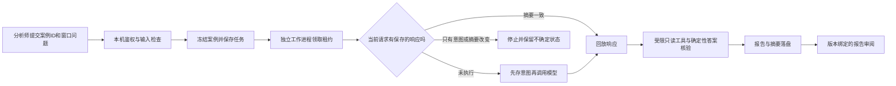

# 架构决定004：先用显式任务状态与响应日志

日期：2026-10-21；范围：G4-A本地任务服务。金融工具、检测器和过去冻结评测不迁移。

## 需要解决的问题

接口重启不能丢任务；两个工作进程不能同时发布同一结果；取消不能被成功结果覆盖；已保存的模型响应不重复请求；只有请求意图而没有响应时，不能假定“没付费，可以重试”。

目前一个任务只有一段受控Agent循环，随后等待人审报告。任务间没有长图分支或多Agent调度需求。

## 方案比较

| 选择 | 能提供什么 | 本项目仍须实现什么 |
|---|---|---|
| 现有CLI与阶段JSON | 简单、已有轨迹 | 并发领取、恢复、取消、请求边界、服务接口 |
| LangGraph与持久checkpointer | 图节点状态、线程检查点、interrupt/resume | 案例权限、模型调用幂等/不确定计费、预算、租约/发布约束、审阅版本 |
| SQLite任务状态＋逐请求响应日志 | 明确的任务、租约、请求回放边界；复用原控制循环 | 自己维护状态机、事务与故障测试，复杂编排扩展能力较弱 |

采用第三项。FastAPI接收受限任务，独立工作进程执行；SQLite事务保存状态、租约和调用日志。恢复时重新构造循环，逐次比对请求摘要并回放已保存响应；只有只读工具可以重算。代码、配置和案例摘要变化会阻止自动恢复。

LangGraph官方说明，持久checkpointer可保存状态；interrupt恢复会从所在节点开头重新执行，因此节点内副作用需要幂等设计。框架检查点不能单独确认一个外部HTTP是否已计费。参考：[持久化](https://docs.langchain.com/oss/python/langgraph/persistence)、[人工中断与恢复](https://docs.langchain.com/oss/python/langgraph/interrupts)。本轮是需求与文档比较，没有做LangGraph性能基准或实际迁移，不声称自研方案普遍优于框架。

## 数据流

模型看不到任务数据库、预算库、全量源库或标签。服务只冻结已有2018案例投影。报告审阅与金融规则批准是两个不同对象；本服务没有金融动作执行器。

## 验收与代价

已实现对同一幂等键的唯一任务、事务领取、租约代数隔离旧工作进程、取消优先的完成事务、180秒跨进程期限、6请求跨恢复预算、材料摘要检查。测试须包括真实进程直接退出后恢复，以及HTTP Mock预算条目总数不因回放增加。

不确定外部调用采用保守停机，可能产生需要人工核对的任务，即使平台实际未收费也不会自动恢复。任务被停止并不等于取消了平台请求。未承诺外部HTTP恰好执行一次。

若后续引入多个可独立恢复的调查分支、显著复杂的人工等待流程，且状态机维护成本增加，再用同一故障测试集验证LangGraph替换执行层。业务边界、预算账本和请求日志仍保留。

FastAPI仅用于HTTP任务接口，工作进程另起；没有把API进程数量当作队列或任务恢复方案。参考：[FastAPI多进程部署说明](https://fastapi.tiangolo.com/deployment/server-workers/)。本轮没有对外发布服务。
