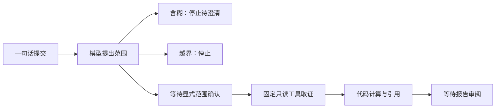

# 决策：模型提出调查范围，代码执行金融判断

状态：已实现，G6-A。背景：G5-A中，工具型Agent在确定性数字任务上没有胜过强固定流程，还出现格式和工具预算问题。

因此保留现有ReAct调查作为对照，不把所有任务强制交给它。新增入口处理自然语言范围，使用一次模型请求，最多一次格式纠正，始终不开放工具。严格JSON只允许五种检查的组合、澄清或拒绝。

计划绑定规范化问题、不可变案例指纹、运行代码指纹和固定业务口径。状态链是：

确认事务检查任务版本、结果哈希和计划哈希；幂等回执跨重启保留。人工等待不占执行时限，确认后开启独立的确定性取证时段，不再获得模型请求额度。取证阶段可重做只读查询，但不会再次调用模型。范围阶段沿用响应持久化、租约和不确定请求停止机制。

模型只能提出范围，不能批准自己的计划。共享令牌并不证明真人身份；演示和评测明确区分模拟确认与人工操作。报告审阅也不等于金融规则批准。

备选方案：直接自然语言查询并自动出报告更方便，但缺少语义可靠性证据；为每条中文问法写分支较便宜，但同义表达和否定难维护。两者都作为本轮对照，而非先假定模型有用。没有因此新增多Agent、检索库或框架迁移。

局限：固定五项不覆盖开放式调查；模型语义错误无法仅靠Schema杜绝；没有真实机构专家流程验证。下一轮应先引入独立任务编写和真实用户反馈，再扩大范围，不能仅在当前80题上调到满分就声称泛化。
