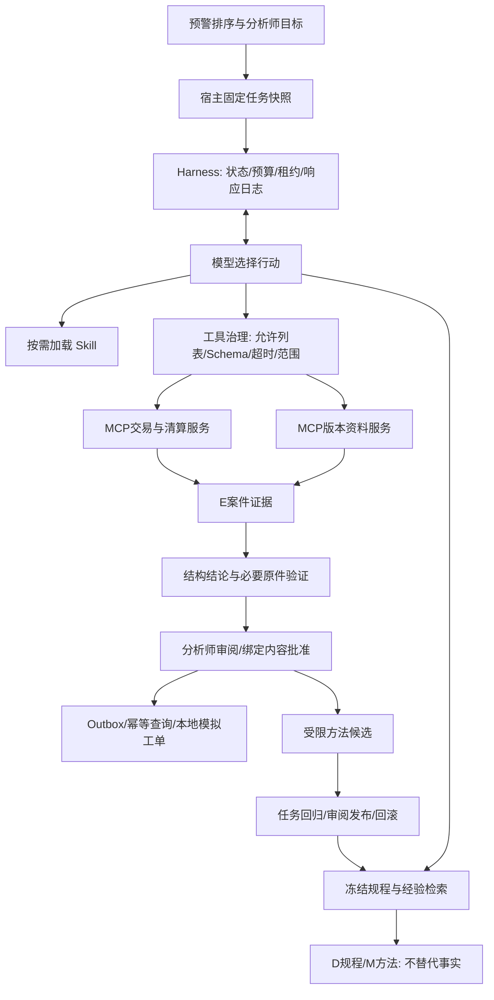

# 多来源证据调查 Agent：面试讲述与追问

这是当前主线的讲述入口。历史范围识别100题、风险检测时间留出，与本轮多步骤Agent评测是不同实验，不混用分母。真实结果以 `STAGE4_REPORT.md` 和对应原文为准。

2026-10-30更新：[原始案卷V4](STAGE5_REPORT.md)两条真实模型路径各6/6通过，限六个已观察合成案例的修复回归；动态4份原件/5次请求，简单路径8份/1次，费用约2.89倍，所以小案卷默认简单路径。[证据包](evidence/dossier-v4/README.md)可脱离本机runs目录查看完整结果及失败样本。新案卷通过[独立入口](RAW_DOSSIER_QUICKSTART.md)准备和显式执行，不依赖评测金标准。

## 两分钟讲述

我做的是支付预警或争议后的证据调查助手。它接收订单和原始案卷，关联订单、收据、支付与台账，区分真正入账、失败重试和排队退款，检索事件日期适用的规程，输出四项可对照原文的主张和待审阅建议。它不认定欺诈、不执行资金操作。

MCP提供两个受控原件服务；宿主负责案件和时间范围、工具schema、预算及来源引用。Skill封装取证方法，不能提升权限。Harness持久化检查点、响应日志和租约代次，结果不明时不盲目重试；审批绑定具体报告和草稿，修改后必须重新批准。引用存在不能证明语义，所以原件直接显示在主张旁，人工逐项核对。

我最初的工具提供了太多预计算判断，规则就能做，于是增加了原始案卷，并用“全部资料一次输入”作为强简单对照。首次实验暴露动态搜索浪费预算、引用只选正例、模型知道资料不全却仍给出不合适建议。修复后在同六个已观察合成案例上，两组都6/6通过；动态少读一半原件，但多花约2.89倍费用。因此小案卷默认简单路径，动态路径显式选择。我保留了失败和原始请求，不把回归当独立泛化，也不把组件齐全当生产价值。

## 本轮可写入简历的三条

- 实现支付原始案卷调查助手，以MCP连接清算、支付映射及版本化规程，支持按来源角色取证、行级引用和完整台账核对，输出绑定原文的结构化主张。
- 构建可恢复调查Harness，管理模型/工具预算、响应日志、租约fencing和内容绑定审批；资料缺口与引用不完整进入受限校验反馈，结果始终待人工语义确认。
- 建立单次全部资料与动态取证对照，保留失败并修复；在6个已观察合成案例回归上两组各6/6，动态读取8→4份原件但费用约2.89倍，据此为小案卷选择简单执行路径。

不要删去“已观察合成案例回归”，也不要把50%原件读取下降改写为50%人工时间节省。单次反馈在最终真实批次没有触发，不能宣称本批靠自纠错提升成功率。

## 核心架构

本地神经检索是已实现并测量的可选实验路径，工作台默认BM25。不要把图中各组件说成独立自治的多个Agent；这里主要是一个模型调查循环和多个可信宿主组件。

## 面试官最值得追问的十五个问题

1. **这个任务为什么需要Agent，规则不就能做？** 旧路径研究规程足够简单，固定代码能解决。新路径由模型阅读原始案卷和关联引用，但仍只有六个已观察短文本案例。动态取证没有证明整体更划算，所以小案卷默认全部资料输入。要展示实际轨迹与调用差异，不能只展示ReAct循环。
2. **MCP和一个普通函数有什么不同？** MCP提供服务发现、协议初始化、工具schema及进程间调用。权限、业务范围、预算不由MCP自动保证。本项目真实跑两个stdio进程，但没有远程OAuth、租户认证或外部MCP市场。
3. **为什么Skill不是长System Prompt？** 目录只载入元数据，选中后才加载正文；引用资源可继续按需读取。内容固定哈希、允许的文件类型和路径边界清晰。Skill是可组合指导，执行权限仍由宿主注册表决定；不是任意脚本沙箱。
4. **有没有把工具返回的指令当成高优先级？** 原文按非可信数据处理；最终注入邮件只曝光给全部资料组，动态组未读取，不能拿它作等曝光抗攻击对照。工具允许列表和单案范围不会因正文改变。提示注入仍可能影响模型结论，所以还需引用与规则验证，不能把一句“忽略注入”当完整防护。
5. **什么是Harness，哪些状态属于它？** 它管理任务生命周期、工具/请求预算、持久检查点、上下文视图、审批和可观察轨迹；不负责替模型偷偷纠正错误答案。展示phase、cursor、generation和pending call，而非背术语。
6. **崩溃时如何保证不重复调用？** 只读工具可以计入预算后重读。模型请求先记录意图，已保存响应按请求哈希重放；没有确定响应则停止。租约代次拒绝旧worker写入。无法承诺任意外部API exactly-once。
7. **为什么序列化顺序也影响恢复？** 第二阶段曾因内嵌JSON字典顺序变化导致请求哈希不同，恢复失败。后来规范化请求中内嵌JSON，而不是只规范化外层对象；原失败回执仍在。
8. **上下文压缩有没有丢关键事实？** 保留结构字段、证据编号和未知项；仅截断长正文，并允许按原编号读完整原文。超字节预算停止，不静默删缺口。尚未证明小时级长任务效果。
9. **RAG为什么不直接上向量库？** 先解决可见范围、时间、版本和撤回，再比较召回。语料小，内存计算足够；引入向量数据库本身不证明正确性。部署规模增大后才讨论索引更新、过滤一致性和延迟。
10. **重排模型为什么更差？** 首轮0.75向量阈值压掉候选，又用未校准的重排0分作拒答线，开发Recall@3从90.9%降到68.2%。修复后开发100%仍不是未见成绩。排名logit不是概率。
11. **工作记忆与经验记忆怎么隔离？** 工作记忆绑定单案与检查点；跨案只发布模板化通用方法。源任务和反馈只作私有溯源，不进入M引用。当前单本地范围，不能冒充多租户隔离。
12. **自进化到底实现了什么？** 三类核查方法的受限顺序修订、16例任务回归、审阅、发布、过期和回滚。不能自由生成新技能再自动上线；没有证明模型跨任务自主学习能力。
13. **正确率怎么测，是否把失败删掉？** 结构结论、缺失项、必要原件、引用、完成与宿主验证分别评分；失败留在分母。内部60场景按家族分组，仍是作者生成的合成审计。模型小批次与300次代码执行分别报告。
14. **模型结论正确为什么仍要人工审阅？** 第三阶段出现历史完整却在摘要中说不完整，同时伪造版本引用。枚举和JSON合法不是自由文本语义证明。本项目不执行资金、账户动作，模拟工单也要求批准当前内容哈希。
15. **深度学习部分够先进吗？** 原弱MLP已被残差/MCC嵌入、三种子与匹配强树对照替换；特征Transformer实验更慢且更差，没有为名称强行替换。99与强树94的差异区间跨零。真正补强需要有新增信息的时间序列/合适预训练方法及新评测数据，不是反复使用已观察2019或把检索编码器当风控检测升级。

## 既有工程能力补充：按掌握程度选用

- 实现支付预警多来源调查Agent，连接两个MCP stdio服务，统一治理工具Schema、案件/时间范围、尝试预算、超时与证据来源，并拒绝无原件支持的结构结论。
- 构建按需Skill加载及持久调查Harness，支持检查点、响应重放、租约fencing、知识版本冻结和内容绑定审批，通过真实进程中断与幂等模拟工单验证恢复合同。
- 实现BM25/向量RRF/重排对照及受审阅的方法记忆发布，保留检索退化、错误引用和正文失实；建立按家族分组的60场景内部审计与模型组件消融。

结果数字只从本轮报告选用并写清分母。不要把“代码控制60/60”写成“模型准确率100%”，不要将“支持恢复”写成“大规模分布式Agent平台”，不要声称真实银行上线、节省人工比例或自动自进化。

## 七分钟演示与动手准备

1. 一分钟：用 `scripts/open_dossier_review.py` 打开已保存的 `runs/stage5-live-v4/raw-10/all_context`，说明它是实际模型输出、合成材料、免费查看；不是本次重新推理。
2. 两分钟：对照支付映射、完整清算原件与退款台账，解释30000分是已观察净额，台账缺分区，所以按覆盖条款请求资料。指出PAY-UNRELATED和失败重试为什么不能混进目标支付计数。
3. 一分钟：在证据包报告中比较raw-07/raw-08：事实相同，渠道规程不同，建议不同；再打开动态组的逐次请求，说明工具为何按支付关联展开。
4. 一分钟：保存草稿，不勾选语义确认时批准被拒；核对后批准，修改草稿使旧批准失效。提交只到本地模拟队列。
5. 两分钟：展示V2预算耗尽和V3覆盖矛盾，再展示V4两组结果。解释为什么少读50%资料却多花约2.89倍费用，因而小案卷选择简单路径；六个已观察案例不证明普遍优势。

若被追问跨案经验，再用旧工作台展示受限方法候选、回归、发布与回滚；明确它是独立已实现能力，原始案卷路径没有证明跨案经验收益。不要把所有组件都描述成最终结果的必要原因。

准备面试前至少亲自做一次：沿请求→MCP→原文行→主张→审阅读通一条轨迹；在新目录修改开发案卷的付款编号或退款状态，说明预期变化；运行准备/状态命令并确认不产生模型请求；读懂一个失败及其修复测试。付费执行需明确授权，不能只背助手写的讲稿。
