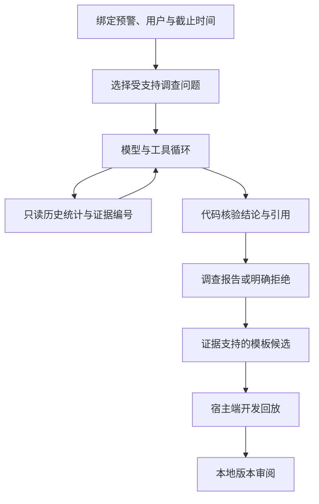

# 架构演进：我们为什么使用或暂不使用这些组件

> 2026-10-22交付补记：本页下方保留各阶段的设计判断。持久任务/恢复、问题转计划、确认后确定性取证和独立100题对照现已完成；当前架构与状态以[RISK_PROJECT_SPEC](RISK_PROJECT_SPEC.md)、[结项报告](FINAL_REPORT.md)为准。未引入LangChain/LangGraph、文档RAG、标准Skill/MCP或长期知识记忆，不把计划写成已交付。

更新：2026-10-18。本页是设计决策和学习说明，未实施内容不能写成已掌握或已交付能力。

## 先回答你的担心

当前核心循环确实来自课程：模型请求工具，程序执行，把结果放回消息，再让模型继续。这个循环本身不是复杂系统。

但项目现在的架构已不只这个循环：我们加了按用户/时间限定的数据投影、类型化工具、不可随意改写的证据、独立数字核验、调用费用预算、任务评测、受限规则提议、开发回放和本地版本审阅。它们分别处理输入、执行、验收和人工决定。

这些不能消除目前的不足：开放问题能力弱、真实模型任务样本少、没有可靠的恢复执行、没有独立保留任务集，也没有真实业务有效性证明。更换框架不会自动补齐这些缺口。

我的判断：需要让你获得框架和组件的实践经验，尤其运行状态管理与证据检索；但必须把每一次引入对应到一个可演示、可测试的实际问题。当前不整体迁移，不一次加入所有技术。

## 用一张表分清它们

| 名称 | 直白解释 | 项目里的实际用途 | 当前决定 |
|---|---|---|---|
| LangChain | 帮你连接模型、工具并搭建 Agent 的开发库 | 减少重复的模型/工具适配代码 | 不是必需依赖；先保留已验证接口 |
| LangGraph | 把任务拆成有状态的步骤，管理分支、暂停和继续 | 调查完成后等待审阅；进程重启后从检查点继续 | 到恢复阶段做同任务小范围对照，再决定采用，不整体重写金融逻辑 |
| RAG | 作答前从外部知识中取相关证据 | 查带版本的调查手册、指标定义、可用的历史案例 | 在调查任务评测之后做有边界的检索试验；没有合适资料时不硬造法规库 |
| Skills | 按需加载完成某类任务的操作说明及配套资源 | 如“商户集中调查”：查哪些窗口、怎样解释分母、何时报告缺口 | 任务足够稳定且重复提示明显后再抽取；普通 Python 函数不改名成标准 Agent Skill |
| MCP | 让不同客户端以共同协议接入工具/资源 | 同一套只读调查工具供 CLI 和第二个客户端复用 | 第二个真实接入需求出现后做适配；不另建重复统计引擎 |
| Memory | 保存当前任务状态，或跨任务复用经过审核的知识 | 本次已查过什么；以后检索已确认且当时可知的案例 | 先做任务状态持久化；跨案例记忆后置，必须防止标签、未来知识与用户数据串用 |
| Harness | 让模型能在受控环境中持续工作的运行配套机制 | 工具权限、上下文、预算、状态、验收、日志、故障处理 | 现已有部分能力；继续完善，不宣称已有完整企业级 Harness |

这些不是同一层的竞品：框架可以组织任务，MCP 接入工具，RAG 取资料，Skills 提供规程，Memory 保存状态/知识；Harness 涵盖运行时的多种配套能力。用了其中一个，并不自动拥有其他几个。

上述区分依据官方资料：[LangGraph](https://docs.langchain.com/oss/python/langgraph/overview)、[检索与 RAG](https://docs.langchain.com/oss/python/deepagents/retrieval)、[Memory](https://docs.langchain.com/oss/python/concepts/memory)、[Agent Skills](https://www.anthropic.com/engineering/equipping-agents-for-the-real-world-with-agent-skills)、[MCP](https://modelcontextprotocol.io/docs/getting-started/intro)、[长任务 Harness](https://www.anthropic.com/engineering/effective-harnesses-for-long-running-agents)。这里的优先级是针对本项目的判断，不是官方规定。

## 哪些已经有，哪些还没有

已有部分运行配套：工具/请求上限、估算费用账本、受限上下文、逐步轨迹、答案核验、部分超时/取消、工作流状态保存、版本和幂等回执。它们可以作为 Harness 相关设计解释，但还不是完整通用 Harness 产品。

已有消息历史，相当于当前任务的短期上下文；已有审阅库，是业务记录。**两者都不能直接冒充跨会话的长期学习记忆。** 已有 SQL 证据查询属于检索外部事实的一种方式；当前没有文档分块、检索评测和版本过滤的文档 RAG 系统。

## 为什么恢复阶段优先评估 LangGraph

具体问题：一次调查查完了数据，接着等人审阅。此时关闭程序，第二天能否继续？继续时是否重复调用付费模型、重复回放或者继承旧版本批准？

现有工作流只把阶段状态写下来，尚不能可靠恢复。LangGraph 的检查点与中断机制与这个需求贴近；它可以独立使用，不要求先把所有代码改成 LangChain 风格。[官方说明](https://docs.langchain.com/oss/python/langgraph/overview)

采用前必须比较：现有接口能否复用、暂停后能否跨进程恢复、失败步骤是否重复产生副作用、审批是否仍绑定材料版本、预算是否跨恢复有效。固定一组相同故障任务，在当前实现和候选实现上比较。若只增加依赖而无实际收益，则保留简单实现并记录原因。

框架不会替我们保证业务动作只执行一次，幂等、版本和权限仍由业务代码负责。没有这些测试，不能因为用了 checkpoint 就声称完成恢复能力。

2026-10-21更新：G4-A已在真实退出/重启场景中补齐本地任务恢复，并记录 [架构决定004](ADR_004_DURABLE_JOBS.md)。采用SQLite状态、租约代数与逐请求响应日志，尚未采用LangGraph；不确定调用停机，未承诺外部HTTP恰好一次。验收见 [服务阶段报告](SERVICE_STAGE_REPORT.md)。下文其余未实施能力仍是条件性计划。

## 2026-10-22：混合任务对技术分工的反馈

G5-A已完成32个新任务用户的问题组合与强固定基线对照。评测部分固定流程16/16，固定证据模型与工具型Agent各14/16；成功的28个主任务中，Agent与固定流程均91次工具尝试。不能用组件数量掩盖尚无收益的结果。

下一步优先将数值结论下沉给确定性工具，模型侧验证自然语言问题到取证范围/计划的能力，保留简单路由基线。此项尚未实现，不能把当前指定检查项接口描述成开放自然语言研究系统。细分本地协议错误诊断也仍有缺口。

本轮实验后修复了“数值正确但工具尝试超限仍写出报告”的问题；新回归验证超限不发布，原冻结成绩保留。详见 [混合阶段报告](MIXED_STAGE_REPORT.md)。尚无新增RAG、MCP、长期记忆或LangGraph实现。

## RAG、Skills、Memory 怎样才有意义

例如问：“商户集中度高，调查员接下来应该查什么？”

- SQL 工具回答事实：“近 7 天 Top1 占 25%。”这是当前用户的数字。
- 检索工具回答依据：“哪一版调查手册要求补查哪些线索？”必须返回来源、条目 ID、版本和适用时间。
- Skill 提供操作规程：“先确认覆盖与分母，再比较用户历史，最后说明反证。”这是怎么做事。
- Memory 可以保存：“这次已经查过哪个窗口”，或在允许条件下取用此前经审核的案例。它不能把模型自己猜的结论永久当成事实。

未来做 RAG 时，先用少量可核验手册/明确标记的教学规程，加关键词检索基线；再判断语义检索是否提高证据召回，不默认向量库必需。评测要包含找不到资料、过期版本、错误引用与文档中夹带指令等情形。手册可以是项目自拟规程，但不能冒充真实机构政策或法规。

历史案例和长期记忆存在特殊泄漏风险：2018 年的调查不能检索到后来才确认的欺诈标签或后续结案结论。按任务截止时间过滤“已知时间”，不只是过滤交易发生时间；没有可得时间证明的资料不能用于声称历史真实在线效果。

## 对求职展示的取舍

如果投递岗位明确要求 LangGraph、RAG 或 MCP，完成对应模块的真实小实验并能解释其故障情况有帮助。但本项目不能保证覆盖所有岗位技术栈。

可展示的能力应该是“我解决了什么问题、为什么选这个组件、怎样验证、有什么代价”，而不是只写一串库名。

例如恢复能力真正完成后，可以解释：“我把调查、核验、人工审阅拆成有状态的步骤；模拟中断后继续执行，并验证不会沿用旧版批准。”在完成之前，这只能写在计划中。

当前能诚实解释的是：自己实现并理解工具控制循环；用确定性代码约束金融数据范围和答案；保留真实模型失败；把规则提议与标签回放、人审隔离。原 V1 尚未完成，不能称为企业生产系统。

## 不改变主线的执行顺序

1. 完成新调查问题的开发用例、真实模型失败定位与同权限对照。
2. 扩展源内案例、冻结独立任务评测，并完成审核容量受限的规则实验。
3. 在恢复/服务化阶段评估 LangGraph，检验运行控制机制；不同时引入多套编排库。
4. 有合适的调查资料与评测问题后，小范围增加检索；按重复规程与第二个客户端的实际需求决定 Skills/MCP。
5. 跨案例长期记忆最后考虑，先证明没有时间泄漏和未经审核知识回流。

这增加了架构评估的学习任务，没有把所有组件变成 V1 强制功能，也没有更改支付反欺诈调查与规则验证的产品目标。
