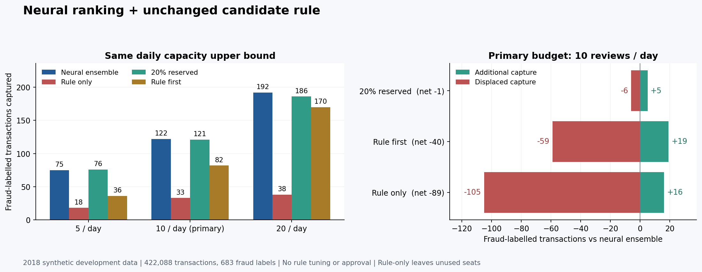

# 深度学习预警接回规则研究：同容量复核实验

本实验已完成12份无标签名单的冻结、2018开发标签核算和独立SQL复核。主要结果：预先约定每天最多复核10笔时，纯深度学习捕获122笔欺诈标签；给旧候选规则保留20%名额捕获121笔，新增5笔、挤出6笔，净变动-1笔。规则优先捕获82笔，纯规则捕获33笔。证据支持继续保留深度学习排序作为研究基线；当前证据不支持批准旧规则替换它。

## 这项工作解决什么问题

模型分数只能回答“哪些交易靠前”。调查Agent提出一条候选规则后，还要回答：“人工每天只能看这么多笔，规则找来的案件，会不会挤掉更值得看的案件？”这里把升级后的三随机种子深度学习集成接回原来的候选规则研究流程。规则与分数先生成名单，名单固定后才核算标签，最后保留可供人审阅的研究包。

标签阳性只代表该合成数据的欺诈标记。本文“捕获”指标签对照后的计数，不代表实际查证、资金追回或减少损失。



## 数据、模型和冻结口径

- 数据：IBM TabFormer合成信用卡交易，2018年开发集，共422,088笔、683笔欺诈标签、365个交易日。该年份已经用于模型选择，不能当作新的独立测试集。
- 排序基线：`neural_v2_ensemble`，来自`runs/neural-v2-development-01`，随机种子42、43、44分数逐元素平均。先检查三份分数与平均结果一致，再按原训练加载器的`transaction_id`排序对齐，逐行绑定422,088个ID。
- 候选：`case-467716-rule`的实际第2版，状态仍为待审阅。本实验只读该候选及其数据库。规则阈值与四个条件保持原样：金额大于32990个最小单位、完整30日历史、有30日历史、商户在30日历史中未出现。数据未证实具体币种，不能把阈值写成人民币。
- 预先固定每日上限5、10、20；主要口径为10。每日离线结束后在当天完整交易中排名，属于回溯式容量实验，不能描述成实时拦截。
- 名单库使用`neural_score`。旧分配器只在内存适配时沿用参数名`hgb_score`，其中装的是深度学习分数，所有持久化结果与报告均明确深度学习基线。

四个方案的实际行为：

1. **纯深度学习**：每天按集成分数由高到低取前K笔。
2. **纯规则**：只从规则命中交易中按金额取前K笔；不足K笔就空缺。因此比较的是相同容量上限，实际复核数可能更少。
3. **规则保留20%**：先从规则命中交易中按深度学习分数取`floor(K/5)`笔，再按深度学习分数补齐剩余名额，去重。
4. **规则优先**：先取规则命中交易；命中组和未命中组内均按深度学习分数排序。

所有方案的并列分数按冻结的交易ID哈希和ID处理，保证重跑名单一致。实际金融候选没有被登记新版本、批准或部署。

## 全部容量结果

新增捕获、挤出损失、净变动均相对相同K的纯深度学习名单。净变动=新增捕获−挤出损失；计数对象是交易。

| 每日上限 | 方案 | 实际复核数 | 捕获欺诈标签数 | 误报数 | 召回率 | 新增捕获 | 挤出损失 | 净变动 | 空位 |
| ---: | --- | ---: | ---: | ---: | ---: | ---: | ---: | ---: | ---: |
| 5 | 纯深度学习 | 1,825 | 75 | 1,750 | 10.98% | 0 | 0 | +0 | 0 |
| 5 | 纯规则 | 1,750 | 18 | 1,732 | 2.64% | 9 | 66 | -57 | 75 |
| 5 | 规则保留20% | 1,825 | 76 | 1,749 | 11.13% | 4 | 3 | +1 | 0 |
| 5 | 规则优先 | 1,825 | 36 | 1,789 | 5.27% | 22 | 61 | -39 | 0 |
| 10 | 纯深度学习 | 3,650 | 122 | 3,528 | 17.86% | 0 | 0 | +0 | 0 |
| 10 | 纯规则 | 2,791 | 33 | 2,758 | 4.83% | 16 | 105 | -89 | 859 |
| 10 | 规则保留20% | 3,650 | 121 | 3,529 | 17.72% | 5 | 6 | -1 | 0 |
| 10 | 规则优先 | 3,650 | 82 | 3,568 | 12.01% | 19 | 59 | -40 | 0 |
| 20 | 纯深度学习 | 7,300 | 192 | 7,108 | 28.11% | 0 | 0 | +0 | 0 |
| 20 | 纯规则 | 3,072 | 38 | 3,034 | 5.56% | 10 | 164 | -154 | 4,228 |
| 20 | 规则保留20% | 7,300 | 186 | 7,114 | 27.23% | 3 | 9 | -6 | 0 |
| 20 | 规则优先 | 7,300 | 170 | 7,130 | 24.89% | 10 | 32 | -22 | 0 |

主要口径的具体含义：保留20%方案把259笔原来没选中的交易换入，也把259笔原先选中的交易挤出。换入交易中有5笔带欺诈标签，换出交易中有6笔带欺诈标签，所以全年净变动为-1。仅看“新发现5笔”会漏掉6笔挤出损失。

每天5笔时保留20%比纯深度学习多捕获1笔；每天20笔时少6笔。这些是预先固定容量下的开发集敏感性结果，不能挑出“+1”的口径作为可靠提升或上线依据。本文没有估计真实业务收益，也没有作统计显著性承诺。

## 主要口径按月检查

| 月份 | 纯深度学习捕获 | 保留20%捕获 | 新增捕获 | 挤出损失 | 净变动 |
| --- | ---: | ---: | ---: | ---: | ---: |
| 2018-01 | 12 | 13 | 1 | 0 | +1 |
| 2018-02 | 6 | 6 | 0 | 0 | +0 |
| 2018-03 | 14 | 14 | 1 | 1 | +0 |
| 2018-04 | 13 | 12 | 0 | 1 | -1 |
| 2018-05 | 1 | 1 | 0 | 0 | +0 |
| 2018-06 | 10 | 11 | 1 | 0 | +1 |
| 2018-07 | 7 | 7 | 1 | 1 | +0 |
| 2018-08 | 3 | 3 | 0 | 0 | +0 |
| 2018-09 | 14 | 13 | 0 | 1 | -1 |
| 2018-10 | 7 | 6 | 0 | 1 | -1 |
| 2018-11 | 27 | 27 | 1 | 1 | +0 |
| 2018-12 | 8 | 8 | 0 | 0 | +0 |

月度拆分用于观察全年汇总是否掩盖得失，不据此重新挑选月份、阈值或分配比例。683笔阳性标签中，纯深度学习在每日10笔时仍漏掉561笔，复核名单中3528笔是阴性；当前系统的误报与漏报都必须明确展示。

## 验证证据

先固定协议、候选状态、代码和输入哈希；再写入无标签总体与12份名单，记录`labels_read=false`；随后只查询2018的`validation`标签并生成报告。独立校验器没有调用分配器：它用SQL窗口函数重新生成12份名单，比对ID、日期、排名；再逐行核对原始特征、规则判定、三种子平均分数与并列键，并独立计算整体和48项月度结果。

- 核对总体行数：422,088。
- 核对名单：12份，名单条目合计45,938。
- 月度核对：48项。
- 实际候选数据库前后SHA-256一致，候选保持第2版待审阅。
- 本模块没有查询2019交易事实或标签，没有任何真实LLM请求。
- 研究包状态：`pending_review_unregistered_material`，只提供审阅材料。

这套SHA核验用于发现文件变化与保证研究来源一致，不能被描述成防恶意篡改存储或合规认证。

机器可读摘要：[capacity-v2-results.json](capacity-v2-results.json)。原始研究目录：`runs/capacity-neural-v2`（本地运行产物，不随Git发布大型数据）。

关键文件SHA-256：

| 文件 | SHA-256 |
| --- | --- |
| `protocol.json` | `df06cdb1a093dd9fbc854bde396e618a6c84e4b033b7cc582a3db4027380370e` |
| `plan-manifest.json` | `7af19b520d9034437fe973980bf4db52526de51d926a62c3a914e150e63f8b70` |
| `labels-opened.json` | `65bf70d73fd9eac4ef11769bb1f6a43a8a4f6c55f70b701d842dff87ee5a1be8` |
| `report.json` | `3b268f810174ce64f7fc56eb2173781dd15cc547d4115cfea79ebdb6bace352b` |
| `verification.json` | `5ddfeeb2ea6f98eb17edbc8b7140392acd165ce1067e75e3dec9278e7a3663ca` |
| `research-package.json` | `afd98a208349a095403a076930d8422ddd96638ff5dc48e7d8432cb2cd292f22` |

## 自己验证

已有本地模型与数据时，检查现有研究结果：

```powershell
.\scripts\run_project.ps1 -m app.cli.capacity_v2 verify --directory runs/capacity-neural-v2
.\scripts\run_project.ps1 -m scripts.export_capacity_v2 --directory runs/capacity-neural-v2
.\scripts\run_project.ps1 -m pytest -q -p no:cacheprovider tests/test_capacity_v2.py tests/test_export_capacity_v2.py
```

从头重做请使用一个不存在的新目录，并保持输入模型、实际候选与代码不变：

```powershell
.\scripts\run_project.ps1 -m app.cli.capacity_v2 all --directory runs/capacity-neural-v2-repeat
```

`all`依次冻结、生成名单、打开2018开发标签、SQL核验。已有目录与重复开封会拒绝，避免静默覆盖证据。如果输入哈希、候选状态或冻结代码改变，现有实验也会拒绝继续；应保留原实验并记录新的研究版本，不能把修改后的内容伪装成原先冻结结果。

小夹具测试包括：计划阶段禁止访问标签库、分数来源改变时拒绝、实际候选数据库改变时拒绝、名单改变时禁止开标签、重新封装哈希后错误排名仍被SQL识别、报告数字改变时核验失败。测试中的2019哨兵数据由我们自行构造，仅用于证明筛选隔离。

## 能诚实展示的能力与剩余限制

这项工作可以用于解释：深度学习输出怎样变成可重复的复核队列；Agent提出的规则怎样经过确定性计算、容量对比与人工审阅；为什么“新找到几笔”不等于“整体更好”。不采用一条未证明有效的候选规则，也是完整研究流程的有效产出。

结果只属于合成数据的反复使用开发集。数据的实际到账时刻、标签确认时刻、币种与真实机构分布没有被证实，不能声称线上时效性或跨机构泛化。没有真实审核员试用、业务损失评估或线上部署证据。当前研究包没有进入实际审批状态，保留此边界。
