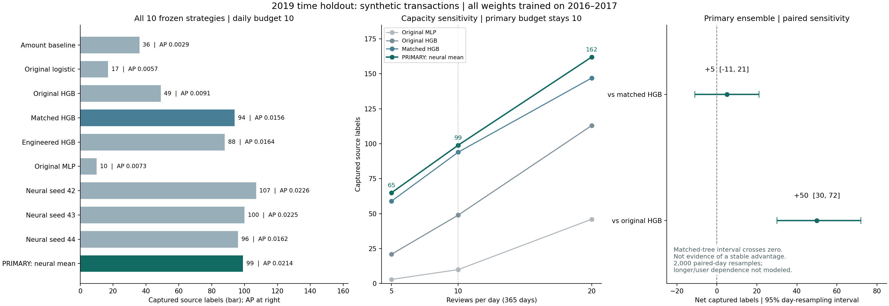

# 2019最终时间保留验证：预警检测结论

**冻结的主模型是三个固定种子的神经网络等权集成。在2019相同每日10笔、全年3,650笔审核名额下，它捕获99笔源欺诈标签；旧MLP为10笔，旧HGB为49笔，匹配输入的强HGB控制为94笔。** 相对旧版本的改进明确，但相对强匹配树只多5笔，日重采样敏感性区间跨0，不能声称已证明稳定战胜强树模型。

本次最终集为IBM TabFormer**合成交易**，423,189笔、523个源正例。训练权重全部来自2016–2017，2018仅用于开发选择，2019用于一次冻结的最终实验。它是时间保留验证，训练与最终期间可以出现同一用户，不能写成独立用户或真实银行业务验证。

## 先冻结，再开最终标签

1. **13:44:30 UTC冻结合同**：确定10种评分方案、主模型 `neural_v2_ensemble`、主预算每日10笔，以及每日5/20笔的次要敏感性口径；复制模型和预处理，绑定代码、数据和参数指纹。
2. 对2019特征进行推理，**不打开标签库**，先保存所有分数与三档完整审核名单；`predictions.json` 明确记录 `labels_opened=false`，并绑定预测数据库指纹。
3. **13:51:35 UTC记录打开标签**：`outcomes-opened.json` 绑定此前预测回执，并声明不再选模型。之后只做评分与独立核验，没有根据2019换配方、轮次或种子。

主网络是开发期选出的原数值+MCC、无渠道、两个64维残差块、正类权重20、固定5轮、种子42/43/44等权平均。最初允许用2018重训的预案没有执行：最终保留所有对照的2016–2017权重，保证相同训练时期。

2019各分区的粗略行数/标签总量此前在数据盘点中已知；未在冻结前评测最终模型排序或其最终效果。这不等于“此前完全不知道2019有多少正例”。本地回执与哈希提供可检查的执行顺序和材料绑定，不是外部机构的不可篡改认证。

## 全部10种方案，不删较差结果

TP是被审核名单捕获的**源正标签数**。每日预算5、10、20分别对应全年1,825、3,650、7,300笔；并列分数使用同一固定哈希规则。AP是Average Precision，和单独某档队首审核效果不同。

| 方案 | AP | TP：每日5笔 | **TP：每日10笔（主口径）** | TP：每日20笔 |
|---|---:|---:|---:|---:|
| 金额排序基线 | 0.002861 | 21 | 36 | 57 |
| 原逻辑回归 | 0.005669 | 4 | 17 | 44 |
| 原HGB | 0.009149 | 21 | 49 | 113 |
| 匹配输入HGB：原数值+MCC、无渠道 | 0.015584 | 59 | 94 | 147 |
| 增强数值+MCC、无渠道HGB | 0.016445 | 58 | 88 | 141 |
| 原MLP | 0.007293 | 3 | 10 | 46 |
| 新神经网络seed42（诊断） | 0.022642 | 63 | 107 | 155 |
| 新神经网络seed43（诊断） | 0.022473 | 62 | 100 | 139 |
| 新神经网络seed44（诊断） | 0.016248 | 49 | 96 | 155 |
| **事前主模型：三种子等权集成** | **0.021383** | **65** | **99** | **162** |

seed42在主口径捕获107笔，高于主集成的99，AP也较高；seed43也捕获100笔。它们仍只是事前登记的诊断对照，**不能看完最终集后把主模型改成seed42并宣布107是主结果**。集成不是必然优于单模型。

在相同每日10笔名额下，主模型相对旧MLP多89笔，相对旧HGB多50笔，相对匹配HGB多5笔。这里没有对所有树模型做全面调参，所以不能将对照表解释成深度学习普遍优于梯度提升树。

## 主模型实际能做到多少

| 每日审核上限 | 全年审核 | 捕获源正例 | 源标签口径假阳性 | 查准率 | 召回率 |
|---|---:|---:|---:|---:|---:|
| 5笔 | 1,825 | 65 | 1,760 | 3.56% | 12.43% |
| **10笔（主口径）** | **3,650** | **99** | **3,551** | **2.71%** | **18.93%** |
| 20笔 | 7,300 | 162 | 7,138 | 2.22% | 30.98% |

增加审核量能够捕获更多源正例，同时查准率下降。主口径仍漏掉424/523个源正例，不能写成“解决了欺诈检测”，也不能把捕获数量换算成真实损失减少。预算是日终批量审核上限，不是实时支付授权或拒付策略。

## 与强树模型的差距有多确定

事前固定按天成对重采样2,000次，随机种子20261022；每次保留同一天两种方案的配对关系，统计全年净捕获差。

| 主集成相对对照 | 净捕获差 | 95%日重采样敏感性区间 |
|---|---:|---:|
| 相对原HGB | +50 | [30, 72] |
| **相对匹配输入HGB** | **+5** | **[-11, 21]** |

匹配树的区间包含0，当前证据不足以支持稳定优势。这里的区间只是**按天重采样的敏感性描述**：没有覆盖跨天、同用户或合成生成机制带来的更长相关性，不是因果效果或真实机构总体的置信保证。不能凭其中一个区间不跨0就泛化成真实业务收益。



图的柱形从0开始，展示全部10种方案；主模型保持突出，未把事后更高的seed42重新标为主模型。横线明确展示强匹配树比较跨0的区间。

## 零正例月份与标签可得性

2019年11月34,948笔、12月36,032笔，源标签中都没有正例。两月共70,980笔仍保留在全年分母，主预算下也保留300+310个审核名额，没有为了提高成绩删掉它们。两个零正例月的召回率是**未定义/null**，不是100%；在当前源标签口径下审核的记录均计为假阳性。

整个2019的Online分组也没有源正例，共50,597笔；主模型仍分给它751个名额。主模型在Chip捕获94/482，在Swipe捕获5/41，表现具有明显分组差异。

**源标签为0不等于现实交易已证明安全。** 数据未给出标签确认时间、是否成熟或何时被系统获取；我们不能补造这些时间，也不能把“源数据里没有正例”解释成真实业务没有欺诈或判断其成因。这里评估的是源文件提供的回溯标签，未模拟延迟标签和实际入库可得性。

## 开发结果与最终结果分开报告

| 时期 | 用途 | 源正例 | 原MLP TP10 | 原HGB TP10 | 匹配HGB TP10 | 主集成TP10 / AP |
|---|---|---:|---:|---:|---:|---:|
| 2018 | 反复观察过的开发期，用于配方/轮次选择 | 683 | 42 | 95 | 109 | 122 / 0.026188 |
| **2019** | **冻结后的最终时间保留验证** | **523** | **10** | **49** | **94** | **99 / 0.021383** |

不能把开发期122与最终99直接作同分母比较：两年的源正例数和分布不同。主集成的召回率分别为17.86%和18.93%，AP则有所下降。2019的作用是检验被冻结的整套方案，不是提供下一轮调参反馈；后续若迭代，需要另建验证合同并承认2019已被使用。

## 可复核证据

`runs/final-detector-v1/` 保留合同、模型副本、预测数据库、三档名单、标签打开回执、最终报告和审计回执。10种方案各有423,189笔分数；使用与SQL名单生成不同的Python排序，重建全部30份名单的成员和名次，AP则用手写分组公式与scikit-learn相互核对。随后再次运行同一个只读审计函数，与已保存报告逐字段比对，状态为 `independent_metrics_and_review_membership_verified`。这里的独立性指名单/指标的核验路径，不是第三套模型推理复现或外部银行专家审计。

- `contract.json`：`1a89eb3df70d895baf6a65ee0197d0d6838327f1e9a00ade70184b8f0c19efb4`
- `predictions.json`：`00420dc9b6c2e0a2617dac0082da074b179b01cf8c10c98f0b9a3aff36a29a76`
- `report.json`：`e66a7c6de0fd13545bd142a0cd98198a682952ad781ec81b48ad26af99eef77a`

图只读取这些已冻结的汇总与回执，生成时不重新训练、不重新推理、不打开结果标签记录：

```powershell
.\scripts\run_project.ps1 -m scripts.plot_final_detector_results
```

本轮可以诚实展示：PyTorch完整训练、开发搜索和消融、三种子稳健性、匹配强基线、事前冻结、独立时间验证、成对不确定性与错误分析。尚不能声称真实欺诈识别提升、实时部署、校准概率或稳定战胜强树模型。开发细节见 [第二轮实验](NEURAL_V2_RESULTS.md) 和 [训练讲解](NEURAL_V2_GUIDE.md)。
