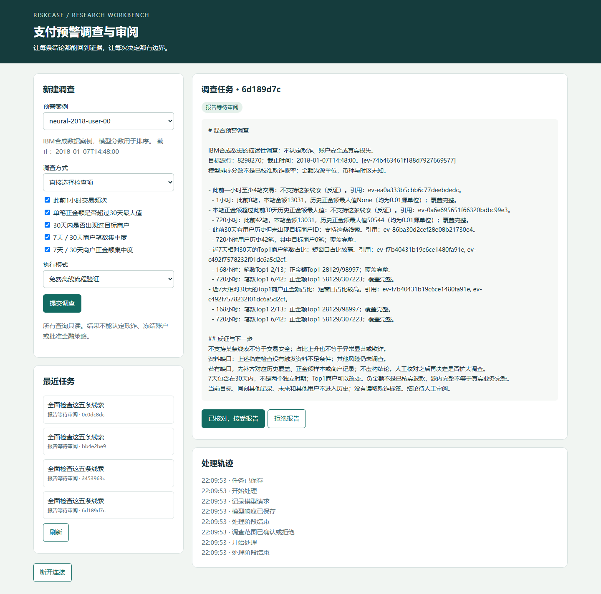

# RiskCase Agent V1结项报告

日期：2026-10-22。交付定位：**本地支付反欺诈研究与调查工作台**。当前版本完成数据、模型、调查、规则研究、服务和演示的闭环；没有将合成研究结果称为真实银行生产成效。

## 产品已能完成的任务

分析师选择预警，输入“只核对频次和新商户”，系统给出明确时间口径的待确认计划。确认后，只读工具查询目标交易之前的记录，代码计算并核验，生成附证据、缺口和轨迹的报告。报告可以接受或拒绝，规则候选另行审阅，系统不自动冻结、付款或发布规则。

直接勾选检查项仍是默认入口；模型自然语言入口用于提出计划。这个分工来自前期固定流程与自由工具Agent的对照，不是把所有步骤交给语言模型。完整边界见[规格与架构](RISK_PROJECT_SPEC.md)。

## 深度学习预警已完成什么提升

使用相同2016–2017训练期，2018开发选择，固定日审核容量。6个预声明配方保留60轮记录，按TP@每天10笔主口径选择；之后固定5轮、3seed。最终模型为MCC嵌入、两块残差网络、37,115参数。尝试过的额外派生特征没有进入获选模型，不能声称它们带来提升。

2019最终时间评测423,189笔、523个源正标签，每天10笔，共审核3,650笔：

| 模型 | 捕获正标签 | 查准率 | 召回率 | AP |
|---|---:|---:|---:|---:|
| 旧PyTorch MLP | 10 | 0.27% | 1.91% | 0.007293 |
| 旧HGB | 49 | 1.34% | 9.37% | 0.009149 |
| 匹配输入强HGB | 94 | 2.58% | 17.97% | 0.015584 |
| **事前规定的三seed神经集成** | **99** | **2.71%** | **18.93%** | **0.021383** |

相较旧MLP多捕获89个源标签，AP约提高到2.93倍。对匹配强树只多5个；以天重采样的敏感区间为[-11,21]，跨0。不能声称深度学习确定胜过强树或残差结构单独造成全部改进。仍有3,551笔误报、424笔漏报，未“解决欺诈检测”。

seed42最终捕获107，高于集成99；因为主模型事先固定，仍保留集成，不事后换种子。2019粗略分区行数与标签总数早期已盘点，冻结后才首次评测最终模型的排序与指标，不能把它描述成从未知道任何2019标签信息。11–12月及Online分组无源正标签，保留所有记录和容量，召回记null，不推断真实安全或标签已成熟。

最终协议、模型、预处理和代码先冻结，随后无标签预测并冻结全部日名单，再读2019结果。独立核验从源投影、ID/日期/并列键与排名重建名单，复算AP/计数并与报告绑定；它不是新一轮调参。详见[最终全部10方案](FINAL_DETECTOR_RESULTS.md)、[开发与消融](NEURAL_V2_RESULTS.md)、[PyTorch讲解](NEURAL_V2_GUIDE.md)。

## Agent能力改进及失败

100道独立编写中文范围题，包含60执行/20澄清/20拒绝；按决策和完整检查集合全对计分，失败保留：

| 方法 | 首次正确 | 最终正确 | 非执行题误列执行 | 运行失败 |
|---|---:|---:|---:|---:|
| 旧关键词 | 73 | 73 | 11 | 0 |
| 旧模型 | 82 | 82 | 0 | 0 |
| 新关键词 | 77 | 77 | 6 | 0 |
| **新模型** | **87** | **89** | **2** | **2** |

四方法400个槽位与400份回执完整，217份按路由范围生成的报告通过独立源SQL核对。另一个独立评分器重算得到相同结果；64题实际输入仅发生固定NFKC/strip规范化，gold未改变。真实请求173次，本批估算1.361260元；新版更长的提示使总估算费用高于旧模型，不能称降低成本。

新版的89/100是本题集范围能力，不能说整套反欺诈正确率89%。新版错误执行2题而旧模型0题，安全指标并非全部改善。217份SQL正确是条件于路由范围的正确，不能弥补选错范围。所有评测确认都是脚本模拟，不能称真人确认。题目来自另一助手，不是金融专家或真实用户；宿主守卫同时变化，不能将改善归因于提示单因素。详见[Agent结果](AGENT_V2_RESULTS.md)。

## 新模型真正接到产品了吗

已准备 `runs/release-demo-v1`：重新加载3份冻结神经模型，对2018全部422,088行重新推理，保存分数最大差异均为0；复核行序和集成均值。按无标签、固定种子的规则，从3,650条日审核名单选4个不同用户案例。

4个案例均接入绑定模型的输入敏感性、离线范围计划、模拟确认、确定性取证和源SQL复核，4份报告停在 `awaiting_review`。103个不可变材料指纹已核验。准备过程0次LLM请求，不读标签或2019记录，不改实际金融审阅库。

敏感性只说明单个模型输入改变时分数怎么变，不是因果或可实现反事实；分数不是已校准欺诈概率。日top10是日终批量审核名单，不是交易发生时已经知道全天排名。完整运行命令见[整合演示](RELEASE_DEMO.md)。

另外有无需IBM下载和模型的自建冷启动页面，明确标手工分数、关键词离线计划和无标签，用于安装验证，不能混入模型成绩。页面、范围确认、资料不足、取消及任务切换已用隔离真实浏览器检查。

## 规则验证为什么没有自动采纳

对实际第2版候选，在2018开发数据固定12份无标签审核名单后评估，独立SQL核验422,088行、45,938条名单记录和48项月度结果。

主预算每天10笔：纯神经集成捕获122，规则保留20%捕获121，新增5、挤出6，净-1；规则优先82。每天5笔保留20%净+1，每天20笔净-6，不挑正结果换口径。

这说明当前规则不支持采用。实际候选保持第2版 `pending_review`、未部署，数据库哈希前后不变；新DL研究包只是未登记的待审阅材料。详见[同容量研究](CAPACITY_V2_REPORT.md)。安全地拒绝坏建议是系统应有输出，不要求每次演示都产生收益。

## 工程验收与可复现性

最终数量、时间、依赖版本、来源哈希和费用由[机器回执](project-final-v1-results.json)从实际文件导出，不靠本文手填。

最终全仓 **724项通过**（命令墙钟313.09秒），干净服务环境相关 **165项通过**（45.31秒），0失败、0跳过。机器回执的suite_seconds来自JUnit套件时间，与命令墙钟计时范围不同。干净环境依赖检查通过，且确认没有安装NumPy/PyTorch。两类测试均有1项Starlette测试客户端的弃用提示，未出现测试失败；没有因此盲目更换已冻结依赖。

累计本地费用账本536条预留，占用估算 **7.430384元**，其中保留1条历史未知费用预留。该数字包含不确定预留，不是经平台核对的实际账单，仍在20元授权估算预算内。密钥继续由本机凭据自动读取，无需每次重填，也没有进入仓库或页面。

- 全仓离线测试覆盖数据/时间/标签隔离、Fake/HTTP Mock、模型小样本学习与重载、严格JSON/工具权限、错误证据、预算、规则/审阅版本和审计绑定。
- 新服务环境单独运行不依赖NumPy/PyTorch的服务/协议测试，依赖检查通过；不将其说成完整干净环境重训。
- 真实进程退出恢复测试验证已保存响应回放；只有请求意图而无响应的情况停止重发，不承诺外部调用恰好一次。
- 页面通过隔离headless Edge核验桌面和窄屏、令牌登录、待确认范围、报告审阅、迟到响应及动作任务绑定。没有使用用户浏览器会话或模型API密钥。
- 另对真实神经合成源整合包进行只读浏览器核验：4案例和4份待审阅报告可见，0个修改请求、服务数据库哈希未变。截图见下方，属于本机展示而非真实用户试用。
- CI已配置Windows/Ubuntu及线程上限；未有远程执行回执，不能写已通过远程CI或部署。

最终归档程序进一步核对预测SQLite、源库、每份Agent回执所引用的子文件和整合包材料，防止仅检查父回执而遗漏子材料变化。对应8项拒绝/合法证明测试已纳入724项；这仍是既有审计的文件绑定核对，不是新一次独立模型效果评测。

浏览器核验脚本另需Node、Playwright及本机Edge，脚本优先使用正常安装，随后才查本机捆绑运行时。本次回执是Windows/Edge，不是跨浏览器矩阵；运行Python工作台本身不需要Node。

本机数据/模型/大型预测库保留在Git忽略目录，代码与小型结果材料进入Git。完整源内重训需要下载并核验源、构建cohort和特征、安装模型依赖；轻量冷启动只需服务依赖。不是从任意电脑直接还原所有本机材料的一条神奇命令。



只导出已验证回执、不给模型新请求：

```powershell
.\scripts\run_project.ps1 -m scripts.export_final_results
.\scripts\run_project.ps1 -m app.cli.release_demo --verify runs/release-demo-v1
```

最终2019不再用于本版本模型选择，不重跑evaluate覆盖旧结果。未来如继续改模型，应另订开发/保留方案，保存这版对照。

## 数据、权利和现实效果

IBM TabFormer是合成源，固定408用户身份群，非独立新用户测试；没有真实设备/IP、征信、损失、标签确认或入库时点合同。币种和时区未确证，商户ID不是实际门店或团伙证据。哈希证明来源一致，不能证明现实代表性或防恶意篡改。

该数据能支撑完整研究管道和工程原型，不能支撑“已验证真实银行完整产品”的结论。数据再分发范围及课程代码公开发布权利仍需核对，本地交付不擅自替上游授权；见[数据卡](DATA_CARD.md)与[NOTICE](../NOTICE.md)。

真实用户效率、真实数据外部验证、生产身份/权限、多租户与金融执行均未验证。没有把“企业级”当作文件数量、框架名称或复杂模型的同义词。V1在本地研究边界结项，后续现实验证是另一阶段目标。

## 给项目作者的交付

[直白地图](START_HERE.md)负责让你跑起来，[学习路线](LEARNING_PATH.md)负责看懂数据、PyTorch和Agent，[面试说明](INTERVIEW_GUIDE.md)提供可用但需自己掌握的表述。课程骨架来源单列在ORIGIN；代码由AI辅助开发，演示成功不等于本人已能独立解释，应据实际理解程度陈述贡献。
