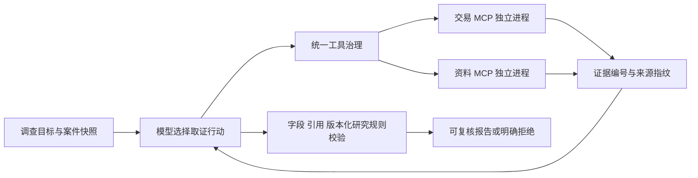

# 多来源证据调查：阶段一验收

2026-10-29。执行依据：[用户确认的主线与四阶段合同](AGENT_ROADMAP.md)。本阶段完成协议、工具治理、分支调查和可审计评测的基础闭环；不宣称完成 Skill、长期记忆、长任务恢复或生产级部署。

## 现在能演示什么

同一组支付预警，根据已获取的交易信号和研究规程，选择清算核对、商户资料、独立处置记录，形成附引用的结构结论及材料缺口。现有工作台保持原流程；新主线通过独立 CLI 和只读 HTML 报告演示，尚未合并进原工作台任务租约生命周期。



真实使用官方 `mcp==1.26.0` SDK；两个服务经 stdio 完成 initialize、tools/list、tools/call，协商协议 `2025-11-25`。握手回执包含服务名称、版本、工具目录和 schema 指纹。不是把进程内函数改名成 MCP。

## 实现合同

- `app/investigation/mcp_server.py`：交易服务提供概览及重复授权组的清算核对；资料服务提供分类检索及原文读取。宿主启动时绑定快照和哈希；工具参数不含可切换的案件或账户。资料按截止时间及当前版本过滤。
- `app/investigation/gateway.py`：本地允许列表和合同优先于服务声明；目录/schema 漂移拒绝接入。参数、结果结构、案件/截止时间、结果大小、12次尝试预算、15秒调用超时统一管理。拒绝尝试也计数；所有工具只读，自动重试为零。每次尝试即时写审计事件。
- `app/investigation/runner.py`：六次请求的最小模型循环，保存解析前原文与工具证据；允许一次禁用工具的格式纠正，计入总请求上限。字段正确但引用或规则矛盾的结论直接拒绝，不重试生成“正确答案”。
- `app/investigation/verifier.py`：仅根据实际引用的证据执行明确的 `research-v1` 研究口径，绝不读取评测金标。它校验结构结论，不证明自由文本每一句都正确，更不是现实金融监管规则。
- `app/investigation/budget.py`：沿用项目 SQLite 费用账本，事务中同时检查单案请求数、单案预算、最多12个案件、批次2元及项目20元上限。未知费用继续占用预留；本地估算不等于平台账单。
- `app/cli/audit_multisource.py`：保存原始结果指纹，使用当前校验器离线重评，另存派生回执及源码，历史答案和评分不改写。

## 开发案例与结果

12个手写合成案例，是6个场景家族的两组变体：重复记录、多笔实际扣款、业务变化、证据冲突、缺处置记录、历史不完整。后一组加入不可信附件指令、旧版本及未来版本。全部是开发案例，不是12个独立业务分布；其中部分恶意文档未被读取时，也不能算成功抵抗攻击。

| 路线 | 结构结论与必要引用通过 | 工具尝试 | 能说明什么 |
|---|---:|---:|---|
| 固定全查代码 | 12/12 | 94 | 明确规则可以由程序完成 |
| 按证据分支代码 | 12/12 | 62 | 代码本身也能减少无关取证 |
| 真实模型，全部已授权尝试 | 9/12 | 86 | 已有真实跨来源调查，但质量和效率未优于代码 |

模型结果分两个协议版本：首例因正文混入 JSON 外而失败；修订后只继续未尝试的11例，其中9例结构结论正确、2例规则优先级错误。不能把两次协议合并称为同一冻结评测，更不能只报9/11隐藏首例失败。

模型在无重复授权的案例中不调用清算工具，而在重复授权案例中调用；缺处置记录时保留缺口，冲突时提出进一步调查。另一方面，两个历史不足案例仍额外查询了商户资料，说明早停效率不足。不存在模型效率增益证据。

## 真实失败及修复

首例共3次请求，输出含解释正文和代码围栏，严格解析拒绝；还把未指定币种表述为美元、扩大了清算统计范围。原始记录在 `runs/multisource-stage1-live-01/`。立即停止后补充单次格式纠正及单位/范围说明，只运行剩余11例，继续使用同一批次预算。修订后11例都使用了格式纠正；模型原生输出遵循度仍弱。

`case-02` 和 `case-08` 中，模型认为“商户变化得到确认”可以覆盖“重复授权对应多笔实际扣款”，违背研究口径。原回答即使字段和引用正确，也不应被接纳。新增研究规则校验器在离线重评中拒绝这两例，保留其余9个有效结构结论；未新增付费重跑来验证新校验器。

逐条文本复核（开发侧，非独立人工评测）还发现：`case-07` 摘要把概览的3条记录描述成重复授权组的3条记录；`case-10` 把附件中的注入指令进一步当作商户解释不可信的理由。这些叙述未被结构校验覆盖。因而9/12不是“9份报告全部事实正确”，自由文本仍标记为待复核。

真实调用共 **61次**，批次费用本地估算 **0.885740元**；未知费用请求0，项目累计估算 **8.838696元**。本次最多12案例授权已使用，未申请或执行额外案例。

## 验证与复现

- 最终核心实现全仓 **797项通过**，220.14秒；1条既有 Starlette/httpx 弃用警告。随后新增离线重评、页面转义及连接收尾失败保留原文测试，针对性回归 **34项通过**，13.96秒；没有再次声称运行全仓。
- 真正跨进程 MCP 测试、服务端绕过宿主后的越界拒绝、时间/版本过滤、无效参数、预算、超时、错误响应、断连模拟及错误结论拒绝。
- 浏览器检查报告、展开原文、窄屏布局；无页面异常及外部请求。截图已查看。
- 所有实验保存提示、源快照、输入快照、握手、模型原文、工具轨迹、引用、评分与费用。免费最终演示：`runs/multisource-stage1-offline-final/`；真实修订协议：`runs/multisource-stage1-live-02/`；最终派生校验报告：`runs/multisource-stage1-validation-final/`。

```powershell
python -m pip install -r requirements-investigation.txt
python -m app.cli.multisource_investigation --output runs/new-offline-demo
# 打开 runs/new-offline-demo/report.html。已有模型报告可直接查看，无需付费重跑。
python -m app.cli.audit_multisource --input runs/multisource-stage1-live-01 runs/multisource-stage1-live-02 --output runs/new-validation-replay
```

本机也可将 `python` 替换为 `.\scripts\run_project.ps1`。依赖版本已固定，Windows项目本地依赖目录处理了 pywin32 的 .pth 加载。新功能依赖见 `requirements-investigation.txt`。

机器汇总与当前代码指纹见 [multisource-stage1-results.json](multisource-stage1-results.json)。连接收尾错误也保留已有原文和证据，避免将已完成的调查覆盖成无内容的错误记录。

## 面试可讲的取舍与边界

可以现场说明：MCP 协议和本地权限策略为何分开；案件快照为什么由宿主绑定；工具拒绝为何也耗预算；为什么字段/引用正确仍需要结论校验；为什么格式纠正不能用来改事实；为什么未知费用不自动重试；如何保留负结果并重评。

当前是可信本地服务的逻辑能力边界，不是 OS 沙箱隔离；没有远程 OAuth 或企业租户认证。结果大小限制在 SDK 解析后执行，不能据此声称能抵御恶意超大字节流。资料工具是按类型检索，没有向量 RAG。12个开发案例仍小且可由规则解决，尚未证明开放规划、真实业务收益或跨分布泛化。最终校验器是明确研究规则的确定性实现；未知规则版本会拒绝，不能把它称为通用事实判官。

下一阶段严格进入 **Skill 与 Harness**：按需加载并固定版本的调查技能、结构化任务状态、恢复与上下文管理、模拟工单审批。接入原工作台和持久化生命周期时复用已有租约/日志，不把本阶段审计文件冒称可恢复执行。
