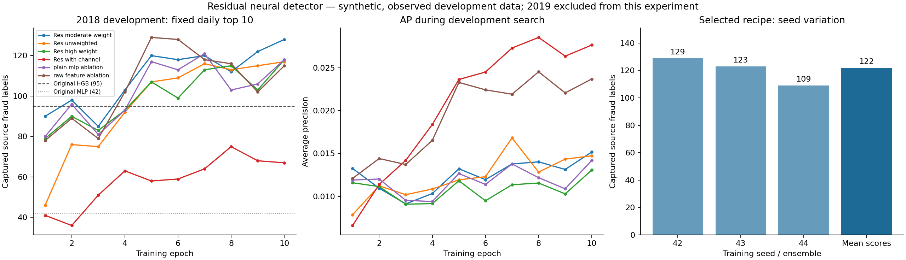

# 深度学习预警第二轮：开发实验、消融与稳健性

本轮在相同的2016–2017训练期、2018开发期和每日最多10笔审核预算下，**三种子神经网络集成捕获122笔源欺诈标签，旧MLP为42笔，旧树模型为95笔**。AP从旧MLP的0.012603提升到0.026188。改善真实记录在产物中，但这是已多次观察过的2018开发成绩，不能代替独立最终验证。

最终2019测试由单独冻结的结项流程负责；本开发实验和独立审计均未读取2019记录或标签。结项时保留这里选出的模型权重，不根据2019分数换配方、种子或轮次。

## 数据与训练合同

训练841,892笔、967个源欺诈标签；开发422,088笔、683个源欺诈标签。每天前10笔、365天，共3,650个审核名额，和历史基线一致。所有排序并列由同一固定哈希规则处理。

本轮没有增加用户ID、交易ID、标签编码或未来全局统计。尝试了由当前14个时点字段推导的相对金额、速度比例和周期特征，但最终按主指标选出的配方没有保留这些新增派生特征。训练期专用中位数/IQR缩放、缺失指示和MCC词表均不使用开发数据拟合。

实验先固定六个配方和每个10轮的上限，记录全部60轮；按“每日前10笔捕获最多 → AP → 更早轮次 → 声明顺序”选优。随后固定选优配方为5轮，重新训练42、43、44三个种子，保留每个种子和等权分数集成。没有删掉较差种子。

原始开发预案曾允许结项前用2018重训；最终保留测试合同在读取2019之前改为：**所有对照都使用2016–2017训练权重，主模型是三个固定种子的等权集成**。可选的2018重训没有执行，历史 `protocol.json` 不被回写。

## 六个配方的全部最好轮次

| 配方 | 选中轮次 | 捕获标签 | AP |
|---|---:|---:|---:|
| 残差、增强特征、正类权重20、无渠道 | 10 | 128 | 0.015161 |
| 同上，权重1 | 10 | 117 | 0.014719 |
| 同上，权重100 | 10 | 118 | 0.013058 |
| 同上，保留渠道 | 8 | 75 | 0.028533 |
| 增强特征、权重20，去残差连接 | 7 | 121 | 0.013772 |
| **残差、原数值特征、权重20、无渠道** | **5** | **129** | **0.023281** |

保留渠道的AP最高，但每日审核捕获明显较低，说明“全排序较好”和“固定少量名额较好”并非同一目标。我们遵循事前主指标，没有看到AP漂亮就临时改目标。去派生特征只比增强配方多1笔，不足以证明这些特征普遍有害；它们在本次有界搜索中没有带来选择优势。

最终网络为：12个数值、各自缺失指示、MCC类别Embedding；64维隐藏表示、两个LayerNorm/GELU残差块、Dropout 0.15、AdamW学习率0.001与权重衰减0.01、正类权重20、梯度裁剪阈值5、批大小4096。参数37,115个。每轮206个批次，末尾不足批次仍处理；训练与预测均检查非有限数值。

## 固定配方后三种子

| 模型 | 捕获标签 | AP |
|---|---:|---:|
| seed42 | 129 | 0.023281 |
| seed43 | 123 | 0.028130 |
| seed44 | 109 | 0.019474 |
| **预先规定的等权分数集成** | **122** | **0.026188** |

单种子捕获均值120.33、样本标准差10.26。集成没有超过最好单种子的129，不能宣称集成总是更好；主模型仍遵循事前集成合同，不换成最好看的seed42。三个种子复用相同样本，不能当作三个独立数据集，也不能据此声称统计显著。

## 与强对照比较

| 方法 | 相同名额 | 捕获标签 | 查准率 | 召回率 | AP |
|---|---:|---:|---:|---:|---:|
| 原始14字段旧MLP | 3,650 | 42 | 1.15% | 6.15% | 0.012603 |
| 原始14字段旧HGB | 3,650 | 95 | 2.60% | 13.91% | 0.016483 |
| 增强数值+MCC、无渠道HGB | 3,650 | 104 | 2.85% | 15.23% | 0.009896 |
| 原数值+MCC、无渠道HGB（最终匹配信息控制） | 3,650 | 109 | 2.99% | 15.96% | 0.010718 |
| **三种子神经网络集成** | **3,650** | **122** | **3.34%** | **17.86%** | **0.026188** |

两个新HGB都保持旧树模型的100轮、15叶、最小叶样本50、学习率0.1、L2=1与平衡类别权重，只改变输入视图。匹配控制避免把新增字段全部当作神经架构贡献。这里没有全面调树模型，不能写成深度学习普遍战胜树模型。

相对旧MLP，集成在相同审核量下多捕获80笔；相对旧HGB多27笔；相对匹配信息HGB多13笔。全部是源标签计数，不能换算成真实损失减少。

## 渠道错误分析

| 渠道 | 源正例 | 旧MLP名额/捕获 | 新集成名额/捕获 |
|---|---:|---:|---:|
| Chip | 564 | 113 / 5 | 2,402 / 83 |
| Online | 28 | 3,394 / 24 | 745 / 13 |
| Swipe | 91 | 143 / 13 | 503 / 26 |

新模型减少Online名额挤占，同时损失部分Online捕获。不能只展示增加的Chip而隐藏Online下降。即使总体提高，最终召回仍只有17.86%，大部分源正例没有进入有限审核名额；这不是“解决了欺诈检测”。



## 工程与独立核验

新增17项机制测试通过：小样本学习、梯度/损失、参数不更新、未知类别、训练专用预处理、标识符/标签列隔离、种子重复、可信模型保存重载、原始/增强树控制，以及含并列分数的独立排名与AP公式。

独立脚本核对所有运行材料指纹、六种配方的60轮行数/批次/最好轮次、每份完整开发分数的AP与审核捕获、三种子和等权集成。每种配方随机样本加高分样本共144笔重新加载核对，容差1e-6；匹配树模型也做保存重载。完整开发实验耗时1,541.641秒（约25.7分钟），CPU最多4线程，未下载新框架、未调用LLM；本机耗时不是服务性能承诺。

本地证据：

- `runs/neural-v2-development-01/`：协议、全部曲线、每种配方检查点、三种子模型、分数、结果与独立核验。
- `runs/hgb-v2-development-01/`：增强输入树控制。
- `runs/hgb-raw-nochannel-v2-development-01/`：最终匹配信息树控制。
- [可提交的汇总与指纹](neural-v2-results.json)。

只核验、不重训：

```powershell
.\scripts\run_project.ps1 -m scripts.verify_neural_v2 --directory runs/neural-v2-development-01 --matched-tree runs/hgb-raw-nochannel-v2-development-01
```

模型结构、训练代码和关键概念的直白说明见 [深度学习指南](NEURAL_V2_GUIDE.md)。这些改进完整保留了开发尝试和弱点；最终泛化结论必须看单独冻结的2019保留验证，不能用本页开发增益替代。
