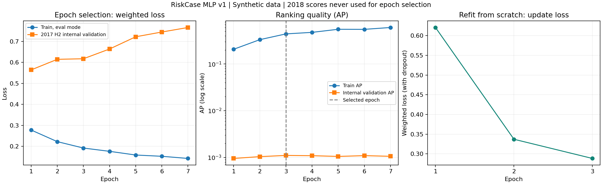

# 第十批结果：PyTorch 训练、早停、重训和复核已完成

更新：2026-10-16。学习入口是 [第十课](lesson10-pytorch-training.md)。本轮把神经网络训练流程实际跑通，成绩没有超过树模型，保留完整结果。

## 现在到哪里了

数据与特征 → 规则和经典模型 → 时间对照 → **本批 PyTorch MLP 首轮完成** → 下一批把检测结果接入 Agent 的业务调查 → 候选规则验证与工程交付。

目前完成的是检测侧实验，还没有完整 Agent 业务闭环。所有成绩来自 IBM TabFormer 合成交易；真实业务有效性与真实匿名源仍是独立待验收项。

## 网络、数据和训练安排

原始输入与经典模型一致，保留 14 个字段，包括支付渠道。类别展开和缺失提示后，两阶段都得到 125 列数字。网络是 `125 → 64 → 32 → 1`，隐藏层使用 ReLU 和 Dropout 0.1，共 10,177 个可训练参数，float32、CPU、2 线程、种子 42。

训练使用 AdamW，学习率 0.001、weight_decay 0.0001，批大小 2,048。损失为 BCEWithLogitsLoss，正例权重只由该阶段训练标签计算，没有再叠加加权采样。输出暂作为排序分数，不解释成现实欺诈概率。

| 阶段 | 学习数据 | 检查/评分数据 | 用途 |
|---|---|---|---|
| 选轮数 | 2016～2017 上半年：628,923 笔 / 904 正例 | 2017 下半年：212,969 笔 / 63 正例 | 决定早停与训练轮数 |
| 重新训练 | 完整 2016～2017：841,892 笔 / 967 正例 | 训练完成后才读取 2018 | 用固定轮数从头训练 |
| 开发比较 | 不再 fit | 2018：422,088 笔 / 683 正例 | 与先前方法同预算比较 |

2018 年是先前已观察的开发验证集，本批没有用它选轮数或改参数。2019 年最终检测测试本批未评测；不宣称 2018 年是全新独立测试。

两阶段的预处理都只 fit 各自学习部分。重训重新建立网络、优化器和预处理，重新设种子，不沿用选轮数阶段的参数。每笔历史特征仍遵守此前的事件时间边界；标签实际可得时间未知，整体仍是回顾性实验。

配置先前已登记，训练实现及依赖记录于提交 `1d3d1bf`；本次运行前又保存 frozen-experiment.json，绑定代码、参数、数据、基线报告和环境版本。

## 为什么最后只重训三轮

预设最多 20 轮；内部验证 AP 连续 4 轮没有超过规定改善幅度 0.000001，就停止。第 3 轮最好，第 4～7 轮没有达到改善要求，因此第 7 轮停止，恢复第 3 轮检查点。

| 轮次 | 轮末训练损失 | 内部验证损失 | 训练 AP | 内部验证 AP |
|---|---:|---:|---:|---:|
| 1 | 0.277796 | 0.563926 | 0.206794 | 0.000953 |
| 2 | 0.222486 | 0.614376 | 0.332062 | 0.001041 |
| 3（选中） | 0.191986 | 0.617079 | 0.441494 | 0.001105 |
| 4 | 0.176278 | 0.663474 | 0.476333 | 0.001091 |
| 5 | 0.158743 | 0.721691 | 0.554268 | 0.001052 |
| 6 | 0.152648 | 0.744377 | 0.552401 | 0.001094 |
| 7 | 0.142474 | 0.765887 | 0.605243 | 0.001058 |

这两列损失都使用轮末固定参数、关闭 Dropout 和相同训练期权重；不是把训练更新中的损失与验证直接混比。训练损失越来越低，内部验证损失却越来越高，AP 也没有持续上升。这是过拟合/时间迁移需要警惕的迹象，不能单凭曲线确定唯一原因。

内部最佳模型按每日 10 笔仍未找到 63 个正例中的任何一笔。AP 选择与队首审核成绩不是同一个目标；本轮遵循预先确定的 AP 停止协议，没有看到这个结果后临时改规则。仅有 63 个正例且集中于两个月，选轮数也有不稳定性。

随后用完整训练期从头跑 3 轮，每轮 412 批，最后一批 164 笔，均未丢弃。最终训练 AP 0.373621，关闭 Dropout 的训练加权损失 0.259513。整个流程约 256.156 秒，含读数据、7 轮选轮数、3 轮重训、预测和保存，是本机耗时而非性能承诺。

选轮数训练正例权重为 694.711，重训为 869.623，两阶段的损失尺度不能不加说明地直接比较。2018 年使用重训时权重算出的损失为 2.513207，明显高于同权重下的重训集损失，仍暴露迁移问题。



左图是选轮数阶段的损失，中图是 AP（纵轴为对数刻度，便于看见相差较大的训练/验证成绩），右图是从头重训时的批次更新损失。右图含 Dropout 且权重在更新，与左图训练集的固定参数损失口径不同。

## 2018 年，同样工作量下成绩如何

每种方法都审核每天前 10 笔，全年 3,650 笔，验证期共 683 笔欺诈标签。

| 方法 | 找到欺诈 | 审核中正常标签 | 查准率 | 召回率 | AP |
|---|---:|---:|---:|---:|---:|
| 金额排序 | 35 | 3,615 | 0.96% | 5.12% | 0.002953 |
| 组合规则 | 40 | 3,610 | 1.10% | 5.86% | 0.005272 |
| 逻辑回归 | 35 | 3,615 | 0.96% | 5.12% | 0.007773 |
| 梯度提升树 | 95 | 3,555 | 2.60% | 13.91% | 0.016483 |
| 本轮 PyTorch MLP | 42 | 3,608 | 1.15% | 6.15% | 0.012603 |

这是相同数据、相同每日预算和并列排序方式下的开发比较；经典模型行来自冻结的首轮结果，没有重新调参。MLP 本轮 AP 和捕获均低于树模型，没有替换检测器的依据；比组合规则多 2 笔也不能写成稳定提升。

MLP 的 ROC-AUC 约 0.8759，比树模型的约 0.8662 略高，但队首审核捕获远少于树模型。再次说明 AUC 不能替代固定预算的审核效果。

## 按渠道拆开，问题更清楚

| 渠道 | 该组欺诈标签 | MLP 分配的审核名额 | 找到欺诈 |
|---|---:|---:|---:|
| Chip | 564 | 113 | 5 |
| Online | 28 | 3,394 | 24 |
| Swipe | 91 | 143 | 13 |

MLP 约 93% 的名额给了 Online，而多数正例在 Chip。这与之前观察到的风险渠道变化相符，提示网络仍可能依赖旧时期的模式；仅凭分组计数不能认定唯一原因。加入神经网络本身没有解决这个问题。后续若做渠道消融、再加权或其他改进，必须登记为新实验，不覆盖本次失败记录。

## 工程检查留下了什么

- 全仓 **175 个测试通过**，其中本批新增 14 项：小样本学习、梯度/参数更新、验证不更新、Dropout 验证行为、固定种子、保存加载、末批处理、内存与异常数值检查、数据时期边界等。
- 八条人为教学数据损失从 0.7859 降到 0.0411；它只证明简单模式可学习，不作为欺诈检测成绩。
- 独立脚本按曲线重算早停与重训轮数，检查每轮处理行数及批数；验证 7 轮选择、3 轮重训均符合协议。
- 从保存的全部 422,088 笔分数，用另一排序方法重建 3,650 条名单，独立累计 AP 与 TP/FP/FN，一致。
- 本机重训网络和预处理重新加载，随机记录加高分记录共 144 笔预测最大绝对差异为 0；预定 float32 容差 0.000001。
- 依赖检查通过。CPU PyTorch 2.8.0+cpu 的来源 URL、文件指纹、依赖版本已记录于 `config/pytorch-installation.json`；没有改动原课程仓库或调用 LLM API。

测试中保留既有 joblib 物理核心探测警告；训练线程显式限定。下载曾中断，固定依赖后重试成功；框架 CPU 包约 619 MB，与仅 10,177 参数的本轮网络不是同一回事。绘图库单独列于 requirements-plots.txt，缓存限定在项目 tmp 中。

## 自己运行什么最有帮助

先在项目根目录跑小演示和测试：

```powershell
.\.venv\Scripts\python.exe -X utf8 -B -m app.cli.neural_demo
.\.venv\Scripts\python.exe -B -m pytest -q -p no:cacheprovider tests/test_neural_model.py
```

复核本次完整运行：

```powershell
.\.venv\Scripts\python.exe -B -m scripts.verify_mlp_run --report runs/mlp-v1-3847f339fc05/report.json
.\.venv\Scripts\python.exe -B -m scripts.plot_mlp_curves --report runs/mlp-v1-3847f339fc05/report.json
```

需要完整重训时使用 `python -B -m app.cli.train_mlp`，使用同一虚拟环境，会新建运行目录。额外依赖分为 requirements-dl.txt（训练）和 requirements-plots.txt（绘图）；现有环境已安装。迁移机器仍需构建此前数据快照并处理 manifest 中的本机路径，不宣称已完成一键跨机器交付。

运行目录 `runs/mlp-v1-3847f339fc05/` 保存：冻结配置、逐轮曲线、选轮数/重训参数、各自预处理、网络结构、无标签预测和名单、报告、复核结果及曲线图。该目录为本机忽略产物；文档另外提交一份只含汇总指标的曲线图，便于跨机器阅读。只加载自己生成的可信参数与 joblib。

主要指纹：

- report.json：`a2cc4ae1d928d18552b78ea7c76be423ec7a0ebd1ce6dfcb058299a241a786c2`
- frozen-experiment.json：`62b63e61fe9baaf0c7ec91f0dd9411863aa7d097ae46086e48d3d4af04902e38`
- refit-model.pt：`74a45c926fb50ef0abe411b7f2f570c48fcf47b01a6b555d5c2525f785f2233c`
- validation-scores.npz：`65d87d4bc532afbcd59fbb3070604fa4bcd207fbd06b8d494582bac9293d6bf9`

## 后续判断

经典模型、时间消融和一个完整 PyTorch 训练流程已有首版证据。当前应把现有检测版本、交易事实和受限历史工具连接成可调查的 case，让 Agent 能查证或反驳初始怀疑，并分别评测工具证据与结论。模型改进继续保留接口与实验记录，不无限追加分类器而推迟业务闭环。

本轮可展示“按时间训练/早停/重训、类别不平衡、PyTorch 训练循环、模型保存复核和失败分析”；不能写成已实现生产欺诈识别或已经证明 Agent 提效。理解这些输入、更新步骤和评测限制后，才有依据在面试中解释自己的实现。
