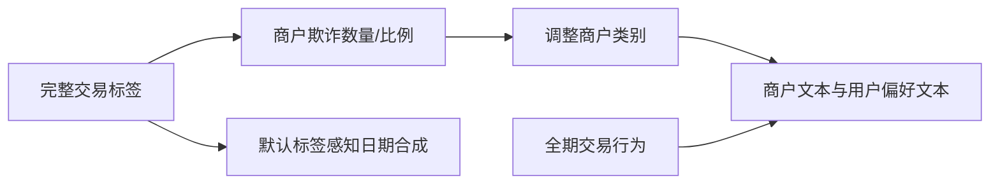

# Gate C1｜数据候选与语义生成链的只读审查

## 当前决定

本次完成来源和代码层面的可行性预审，**尚无候选获准进入C2模型实验**。没有下载、解析新候选的交易行、描述行或评测标签，没有调用生成服务。Gate B仍按原协议运行；这份并行预审不改动B的模型、预算或候选规则。正式C2须等待B独立核验及新的数据使用/切分协议。

已逐文件校验28份官方源文件的Git blob和SHA256；另检查Handbook官方notebook的32个代码单元，未检查输出、未执行源代码。版本、原始文件指纹、官方链接见[candidate-source-fingerprints.json](candidate-source-fingerprints.json)。审查协议在`c8a229dc8ccbbc62bcfa67f3eba50114fb17d6b2`登记；协议明确记录此前已经阅读过公开README元数据，不倒称为完全盲审预注册。

| 候选 | 已查到的事实 | 尚缺证据/准入决定 |
|---|---|---|
| MS-FFSD | 默认代码用目标标签调整商户语义；全期聚合生成主体文本；日期也是合成且默认label-aware | 拒绝用默认链证明合法时点语义增益；发布ZIP未打开，实际受影响商户/交易数量未知 |
| IEEE-CIS | 官方交易/身份表通过TransactionID关联，身份表覆盖不完整；有设备/软件类字段 | 官方条款、合法访问、具体版本、字段可得性和主体定义未核验，暂缓 |
| Sparkov | MIT生成器；职业与商户名由Faker生成，类别来自生成规则 | 可筹备模拟机制对照；尚未证明具有超出普通类别字段的充分业务文本，未生成数据 |
| Fraud Detection Handbook | GPL参考代码；有明确模拟时点和欺诈生成机制 | 适合时序/标签延迟机制对照；不提供业务描述文本；未生成或下载数据 |

`failed`表示当前所审默认流程存在相反证据；`unknown`表示没有完成核验。这两种状态都不作为准入通过。此处的“标签独立”指**构造模型输入时不读取目标/评测标签来加工答案信息**，不要求风险特征与标签在统计上独立。

## MS-FFSD：需要审查上游依赖，而不只查文本中的风险词

固定版本：[`2f68bee4a1b7327e745acb49b607df7ad503c100`](https://github.com/AI4Risk/MS-FFSD/tree/2f68bee4a1b7327e745acb49b607df7ad503c100)。发布目录列出transaction、user、merchant及两份主体描述表，Source/Target是关联键；标签定义为0正常、1欺诈、2未标注。发布ZIP约2.20MB，Git blob为`149280fba3fa4086634b4264aa27025ce648d2f5`；只检查了目录元数据，没有打开ZIP。[官方数据说明](https://github.com/AI4Risk/MS-FFSD/blob/2f68bee4a1b7327e745acb49b607df7ad503c100/README.md)

默认调用链存在以下可定位依赖：

1. `run_pipeline.py`的优化阶段调用`apply_merchant_fraud_semantics.py`，之后才生成和发布文本。[入口L33–40](https://github.com/AI4Risk/MS-FFSD/blob/2f68bee4a1b7327e745acb49b607df7ad503c100/run_pipeline.py#L33-L40)
2. `build_label_summary`按商户汇总完整交易表中的正常数、欺诈数、未标注数及欺诈率。`fraud_evidence_mask`使用欺诈数量/比例筛选商户；主流程据此更改`behavior_level1/2`，写回`target_final.csv`。[标签汇总L231–242](https://github.com/AI4Risk/MS-FFSD/blob/2f68bee4a1b7327e745acb49b607df7ad503c100/consistency_optimization/code/apply_merchant_fraud_semantics.py#L231-L242)，[筛选与改写L375–420](https://github.com/AI4Risk/MS-FFSD/blob/2f68bee4a1b7327e745acb49b607df7ad503c100/consistency_optimization/code/apply_merchant_fraud_semantics.py#L375-L420)，[写回L450–461](https://github.com/AI4Risk/MS-FFSD/blob/2f68bee4a1b7327e745acb49b607df7ad503c100/consistency_optimization/code/apply_merchant_fraud_semantics.py#L450-L461)。
3. 文本入口默认读取该`target_final.csv`。用户画像也通过商户类别生成偏好类别，因此影响路径可能同时进入用户文本。用户画像按完整传入交易表聚合次数、金额、日期模式，并使用全表金额分位数，没有逐目标交易的as-of截断。[默认输入L25–27](https://github.com/AI4Risk/MS-FFSD/blob/2f68bee4a1b7327e745acb49b607df7ad503c100/long_text_generation/run_long_text_generation.py#L25-L27)，[聚合L224–260](https://github.com/AI4Risk/MS-FFSD/blob/2f68bee4a1b7327e745acb49b607df7ad503c100/long_text_generation/run_long_text_generation.py#L224-L260)，[偏好类别L294–301](https://github.com/AI4Risk/MS-FFSD/blob/2f68bee4a1b7327e745acb49b607df7ad503c100/long_text_generation/run_long_text_generation.py#L294-L301)。
4. 发布器读取相同商户表，将`behavior_level1/2`改名为公开MCC层级，并一起发布描述。[发布读取L78–82](https://github.com/AI4Risk/MS-FFSD/blob/2f68bee4a1b7327e745acb49b607df7ad503c100/publish_dataset.py#L78-L82)，[类别输出L125–126](https://github.com/AI4Risk/MS-FFSD/blob/2f68bee4a1b7327e745acb49b607df7ad503c100/publish_dataset.py#L125-L126)。



即使提示词禁止出现欺诈/风险措辞，类别选择仍可能携带标签派生信息。保持原始标签值不变，也无法证明生成输入没有读取这些标签。上述结论针对**可检查的默认生成代码**；没有发布构建清单和逐行核验，不能声称已经测出发布数据中受影响样本的比例，也不据此推断作者意图。

日期风险同样需要单列。项目实际包装器明确设置`fraud_controller_mode="label_aware"`，并同时读取S-FFSD标签及IEEE参考标签；合成器使用标签参与时间块选择，并声明生成时间不是实际时间。[实际包装器L118–143](https://github.com/AI4Risk/MS-FFSD/blob/2f68bee4a1b7327e745acb49b607df7ad503c100/timestamp_synthesis/run_ffsd_timestamp_synthesis.py#L118-L143)，[时间块逻辑L496–523](https://github.com/AI4Risk/MS-FFSD/blob/2f68bee4a1b7327e745acb49b607df7ad503c100/timestamp_synthesis/synthetic_timestamp_generator.py#L496-L523)。这可以服务于有明确范围的模拟研究；它不能直接证明真实业务发生时文本已可用。

上游[`AI4Risk/antifraud@65e583f`](https://github.com/AI4Risk/antifraud/tree/65e583f03ac5c5983e49cc35179fe7a65908b9c1)把S-FFSD说明为模拟的小型数据，Time范围与交易数量有关；不能把这个序号直接当真实秒级物理时钟。MS-FFSD根目录是Apache-2.0，上游仓库是GPL-3.0，MS说明也要求遵守上游数据条款。本轮未完成IEEE条款核验，不能仅凭一个根目录LICENSE就宣称所有输入与再发布权利均已核验。[上游说明与许可证](https://github.com/AI4Risk/antifraud/tree/65e583f03ac5c5983e49cc35179fe7a65908b9c1)，[MS来源说明](https://github.com/AI4Risk/MS-FFSD/blob/2f68bee4a1b7327e745acb49b607df7ad503c100/README.md#acknowledgements)

后续可接受路径是：取得可核验的原始来源与许可；按模型实际输入清单重建不读取目标标签的类别/画像；仅使用目标之前且当时可得的事实；冻结新切分和候选规则，再打开评测标签。若只有全期行为聚合问题，可考虑明确静态范围；**标签派生的类别、描述或事后加工时间必须另行修复，不能由“静态研究”豁免**。本轮不继续在这个默认流程上训练更大的LLM或TF-IDF。

## IEEE-CIS：保留候选，访问和字段语义尚未通过

[官方数据页](https://www.kaggle.com/competitions/ieee-fraud-detection/data)说明TransactionID关联交易和身份表，部分交易没有身份信息，TransactionDT是参考时点偏移。DeviceInfo、id_30、id_31可能含设备或软件事实；匿名字段名和卡属性组合不能直接当经过验证的真实用户身份。[官方主办方字段讨论](https://www.kaggle.com/competitions/ieee-fraud-detection/discussion/100304)

本轮网页读取未得到可审阅的规则正文；内置浏览器初始化失败，备用浏览器授权超时，尚未进入目标页面。没有接受条款、操作登录或从镜像取数。具体文件版本、许可使用范围、身份覆盖率、字段时点、实体隔离方案均保留为未知。未来先完成这些事项，再冻结时间切分、近重复处理、主体外推与已见主体两种问题的区别、文本字段白名单以及TF-IDF/轻量Encoder/Qwen/随机与打乱对照。不能先看新评测标签再宣布外部留出。

## 两个模拟候选能回答什么

Sparkov固定[`b5eb45c`](https://github.com/namebrandon/Sparkov_Data_Generation/tree/b5eb45c89d36f2aa4ef16044a42945bed8b96d93)，MIT许可针对该生成器。静态商户脚本按类别调用Faker生成公司名；客户职业也由Faker生成，而profile选择使用年龄、性别和城市人口。不能把随机名字/职业包装成已验证的业务叙事。这条线可以用于冻结生成规则后的时序机制对照，但尚未构成充分业务文本的证据。[商户脚本](https://github.com/namebrandon/Sparkov_Data_Generation/blob/b5eb45c89d36f2aa4ef16044a42945bed8b96d93/static_merchant_generator.py)，[客户与profile逻辑](https://github.com/namebrandon/Sparkov_Data_Generation/blob/b5eb45c89d36f2aa4ef16044a42945bed8b96d93/datagen_customer.py#L63-L75)

Handbook固定[`81cf7d1`](https://github.com/Fraud-Detection-Handbook/fraud-detection-handbook/tree/81cf7d1714bb7b2f5b496407d9055d91dc68dc25)。代码GPL-3.0、文字和图片CC-BY-SA4.0；独立数据发布物权利仍须单独核验。参考模拟器提供交易日期、金额、客户/终端标识和欺诈场景；`TX_FRAUD_SCENARIO`直接属于结果构造信息，必须排除。生成器潜在参数也不能未经可得性定义直接当线上已知特征。参考评测的7日标签延迟是建模假设，其卡级Top-K也不同于本项目的逐交易每日Top-10。[官方许可说明](https://fraud-detection-handbook.github.io/fraud-detection-handbook/Foreword.html)，[参考切分与指标](https://github.com/Fraud-Detection-Handbook/fraud-detection-handbook/blob/81cf7d1714bb7b2f5b496407d9055d91dc68dc25/Chapter_References/shared_functions.py#L133-L173)

两个模拟来源均未下载/生成数据，不与IBM或其他来源拼接成同一主体案例。缺少合格文本意味着本轮暂时没有条件检验预训练语言知识的独立增量；不能从这个可行性结论推出“LLM在所有欺诈数据上无效”。

## 复现与后续准入

证据状态输入：`config/semantic-detection/v21-c-source-evidence.json`。代码`v2/data_admission.py`要求来源、版本、使用权利、实际产物指纹/结构、输入白名单、无标签派生、时点、切分和标签封存逐项通过；未知不会自动通过。元数据复现命令只输出预审决定，强制B未核验、实验数为0，不打开候选数据：

```powershell
.\scripts\run_project.ps1 -m app.cli.semantic_detection_source_admission --evidence config/semantic-detection/v21-c-source-evidence.json --output runs/semantic-v21-c-admission-repro-01
```

输出目录必须是新目录。6项门控测试覆盖标签派生、未来文本的静态边界、未知许可、未封存标签、B未完成、真实未知标签与可控隐藏标签的区别，以及未打开的数据产物。结果见`candidate-admission.json`与验证清单。

Gate D仍等待B独立核验。IBM原始标签可得时间缺失，不能宣称真实延迟已知；用户允许的训练期隐藏已知标签，可在另行冻结明确回顾性可控可得性假设、冷启动、训练池隔离、可见类别数与损失尺度后研究。不能复用完整监督权重后把它称为低标签学习，也不能把真实未标注当正常。当前没有D效果结论。
