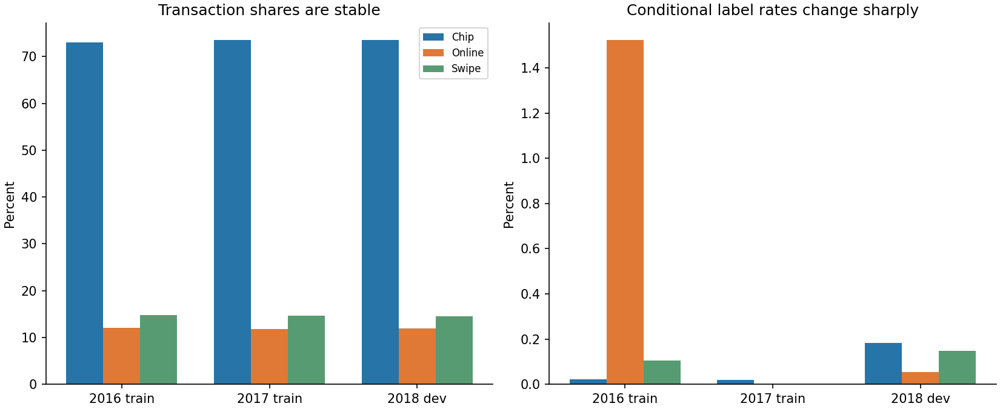
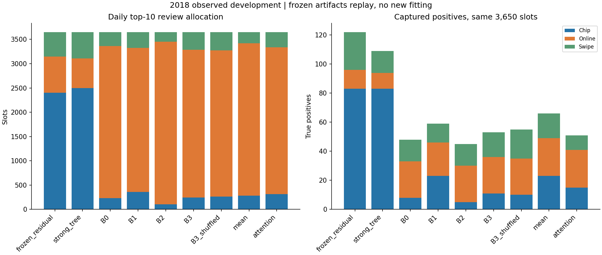

# 渠道偏置审计：Gate A1

本报告只复核旧权重，不训练新模型。统计期为2016、2017训练年及2018已观察开发年；不选取2019记录。原始事实库与标签库独立SQL计数与特征适配器完全一致；全部9组模型按各自真实配置重载，所有seed的开发分数复现误差均不超过1e-6。

## 样本和标签

| 年份 | 渠道 | 交易 | 正例 | 负例 | 正例率 | 交易占比 |
| --- | --- | --- | --- | --- | --- | --- |
| 2016 | Chip | 306463 | 65 | 306398 | 0.0212% | 73.08% |
| 2016 | Online | 50750 | 773 | 49977 | 1.5232% | 12.10% |
| 2016 | Swipe | 62155 | 66 | 62089 | 0.1062% | 14.82% |
| 2017 | Chip | 310577 | 63 | 310514 | 0.0203% | 73.51% |
| 2017 | Online | 50095 | 0 | 50095 | 0.0000% | 11.86% |
| 2017 | Swipe | 61852 | 0 | 61852 | 0.0000% | 14.64% |
| 2018 | Chip | 310348 | 564 | 309784 | 0.1817% | 73.53% |
| 2018 | Online | 50576 | 28 | 50548 | 0.0554% | 11.98% |
| 2018 | Swipe | 61164 | 91 | 61073 | 0.1488% | 14.49% |

交易构成变化很小；标签条件分布变化很大。2016的Online有773个正例，2017为0，2018为28；2018的Chip有564个正例。不能把它称为交易渠道组成突然变化，也不能未经匹配实验将它全部归罪于LLM。

| 训练年份 vs 2018 | 渠道组成总变差 | Cramer V | 列联检验p（未校正） |
| --- | --- | --- | --- |
| 2016 | 0.004495 | 0.005334 | 6.33074e-06 |
| 2017 | 0.001479 | 0.002667 | 0.0496528 |

大样本下微小效应也可有小p值，须优先看效应量与实际名额损失。逐渠道正例率Fisher检验、六项Bonferroni校正、每月明细及用户/用户卡正例集中度见机器回执。2016 Online正例涉及201个用户、259个用户卡；头部用户仅占2.59%，不支持将该现象解释为单个异常用户驱动。标签只有二元事件关联，未证明结案或可得时间；不推断真实世界欺诈机制改变。

## 2018每日Top-10名额

| 模型 | Chip 名额/TP | Online 名额/TP | Swipe 名额/TP | 总TP | AP |
| --- | --- | --- | --- | --- | --- |
| frozen_residual | 2402 / 83 | 745 / 13 | 503 / 26 | 122 | 0.026188 |
| strong_tree | 2499 / 83 | 608 / 11 | 543 / 15 | 109 | 0.010718 |
| B0 | 234 / 8 | 3129 / 25 | 287 / 15 | 48 | 0.032735 |
| B1 | 356 / 23 | 2971 / 23 | 323 / 13 | 59 | 0.034641 |
| B2 | 101 / 5 | 3350 / 25 | 199 / 15 | 45 | 0.033400 |
| B3 | 242 / 11 | 3046 / 25 | 362 / 17 | 53 | 0.033178 |
| B3_shuffled | 264 / 10 | 3012 / 25 | 374 / 20 | 55 | 0.032644 |
| mean | 280 / 23 | 3143 / 26 | 227 / 17 | 66 | 0.042414 |
| attention | 311 / 15 | 3027 / 26 | 312 / 10 | 51 | 0.038057 |

B2将91.78%的名额分给Online；该渠道仅占当年交易11.98%、正例4.10%。3350个名额捕获25个正例、产生3325个FP。原模型745个Online名额捕获13个正例。B2多分配2605个Online名额只多捕获12个Online正例；与此同时Chip捕获83→5、Swipe捕获26→15，总捕获122→45。这里是按渠道总量的差额，不等于逐交易新增/挤出的数目。

逐交易比较：B2相对原模型新增正例14，挤出正例91，净变化-77；配对日95%描述区间[-104.0, -52.975000000000136]。保留每日明细；区间未解决时间相关、多轮开发选择或多重比较问题。

## 同批交易的日内排名变化与失败样例

| 日期 | 挤出正例别名 | 正例渠道 | 原排名 | B2排名 | 新增Online负例别名 | 原排名 | B2排名 |
| --- | --- | --- | --- | --- | --- | --- | --- |
| 2018-01-03 | 8d477fcec4f74397 | Chip | 8 | 151 | e933890eba1d510a | 28 | 1 |
| 2018-01-05 | 04147c16ae5ff54a | Chip | 6 | 34 | eded09183b6ad43a | 57 | 8 |
| 2018-01-10 | 8a33e06a8b346ba0 | Swipe | 7 | 24 | 5f229cc8935b0a84 | 40 | 7 |
| 2018-01-11 | 3ffcc85e70340376 | Swipe | 5 | 11 | 37ac9364b22ae8a6 | 21 | 10 |
| 2018-01-31 | ef3076fee6094be5 | Chip | 6 | 35 | b2968bfe4534f89b | 187 | 9 |
| 2018-02-01 | 71a50a8b5d10b150 | Chip | 1 | 28 | 3a10aa5a2efe7cef | 61 | 9 |
| 2018-02-07 | 916eab26b68e18c0 | Chip | 1 | 29 | 97b9259fddd48f77 | 36 | 5 |
| 2018-02-12 | ccb27bbca3828e89 | Chip | 6 | 13 | 74415bff75564ec2 | 287 | 10 |

样例是同一日固定容量下的竞争证据，不能据此认定单笔交易的某字段造成了真实欺诈。完整模型分数、每笔日排名、同批输入行序哈希保留在本地回执；公开汇总只保留别名和必要的派生信息。

## 可核查明细

- `channel-scores.csv`：每个模型×年份×渠道的均值、1/10/50/90/95/99/99.9/100分位数。
- `mcc-channel-scores.csv`：相同分位数按MCC与channel组合展开，包含样本量和正例数；小组不当作稳定效果。
- `rank-changes.csv`：相同交易在原模型/B1/B2/B3及历史模型间的渠道名额变化、日排名相关、正例排名与新增/挤出数。
- `month-channel-counts.csv`：独立原始SQL的逐月计数；`a1-evidence.json`绑定来源、配置、分数重放、漂移检验和例子。

## 当前判断与后续准入

已找到“训练中Online是强风险线索、开发期该线索反转，固定每日容量进一步放大损失”的可核验证据。B0和B1同样大量选择Online，说明此现象不限于语义模型；B2较B1进一步失衡的机制仍需A2/A3匹配对照，不能由这张表作因果定论。

原冻结配置实际是engineered=false、include_channel=false、5轮、3seed，与此前报告一致。E1保留的普通类别分支宽度、联合附加分支与原模型不同；新A2保持原残差核心及共同初始化，逐项开关channel和附加表示。

Gate A1完成；Gate A整体尚须完成A2和A3后才能进入Gate B训练。默认检测器不变。

## 原始来源与组合变化补充核验

见[SOURCE_DIAGNOSTICS.md](SOURCE_DIAGNOSTICS.md)：全部1,263,980笔选定2016–2018记录的源标签核对通过；MCC组合标准化进一步区分组成变化与单元内残差，同时列明语义字典覆盖和不可部署的审核容量上限。原A主实验成绩不变。
