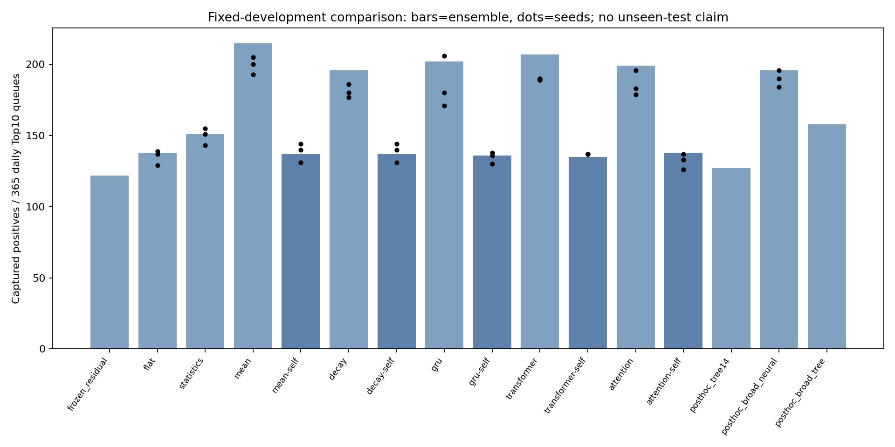
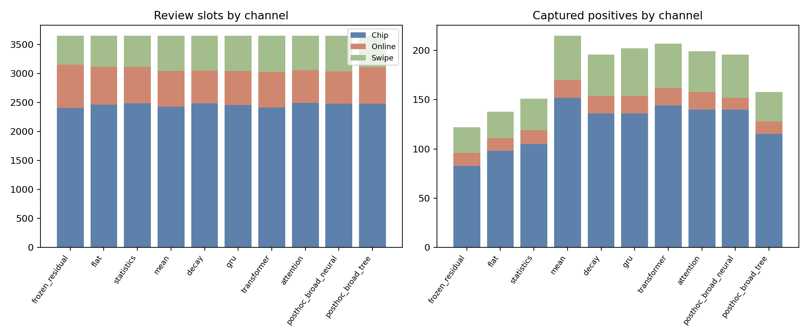
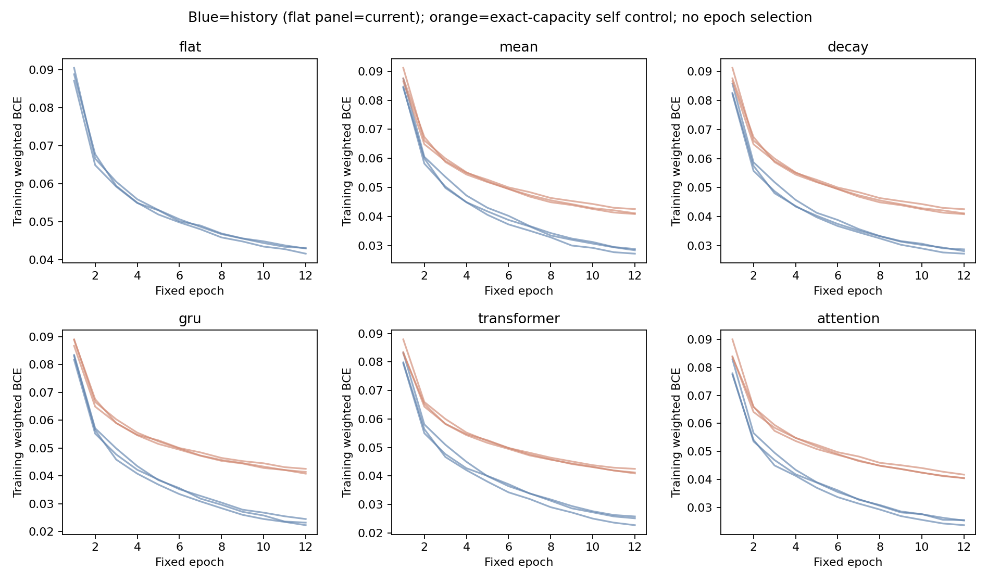

# Gate B：完整监督历史行为研究

全部38个注册实例、5个明确事后登记的强统计挑战已经训练并逐模型重载。Mean在本开发数据捕获215，强平面138，相同参数当前表示控制137，原冻结开发版122。所有架构与负结果一并列出；不把中间最优值包装成最终独立验证。

历史信息的增量有明确对照支持：Mean相对同参数self净增78，7日区块95%描述区间[54.0, 104.0]。但Mean相对220维广统计网络仅净增19，区间[-5.0, 45.0]；区间包含0，尚不能确认Mean表示具有超出该强统计实现的稳定独立增量。

## 数据、预算与身份

训练2016–2017：841,892笔、967正例；2018已观察开发：422,088笔、683正例、365天、3650名额。2019不参与本轮选型或评测。原冻结参考是只在2016–2017训练的开发版三seed残差集成，不能用已在2018再训练的发布权重来评2018。

新模型均从头训练；raw/no-channel残差核心加普通可训练MCC32，无LLM、无半监督。主K6事先固定，各模型12轮、seed42/43/44、4096批、BCE正例权重20、AdamW、固定余弦；不依开发期早停。最后一轮更新开始LR约6.6185e-5，结束后调度到5e-5。等轮数/更新数不等于等FLOPs，成本单列。

## 主成绩与全部控制

| 条件 | seed TP | 集成TP | Precision@10 | Recall@10 | AP | Online名额 |
|---|---|---:|---:|---:|---:|---:|
| frozen_residual | — | 122 | 3.342% | 17.862% | 0.026188 | 745 |
| strong_tree | — | 109 | 2.986% | 15.959% | 0.010718 | 608 |
| flat | 139,137,129 | 138 | 3.781% | 20.205% | 0.032781 | 649 |
| statistics | 151,155,143 | 151 | 4.137% | 22.108% | 0.040969 | 635 |
| mean | 200,205,193 | 215 | 5.890% | 31.479% | 0.090584 | 615 |
| mean-self | 140,144,131 | 137 | 3.753% | 20.059% | 0.031940 | 645 |
| decay | 186,180,177 | 196 | 5.370% | 28.697% | 0.076079 | 568 |
| decay-self | 140,144,131 | 137 | 3.753% | 20.059% | 0.031940 | 645 |
| gru | 206,171,180 | 202 | 5.534% | 29.575% | 0.084866 | 586 |
| gru-self | 138,136,130 | 136 | 3.726% | 19.912% | 0.031957 | 653 |
| transformer | 189,190,190 | 207 | 5.671% | 30.307% | 0.095832 | 615 |
| transformer-self | 137,137,137 | 135 | 3.699% | 19.766% | 0.031647 | 660 |
| attention | 196,183,179 | 199 | 5.452% | 29.136% | 0.087866 | 566 |
| attention-self | 133,137,126 | 138 | 3.781% | 20.205% | 0.030960 | 658 |
| mean-k12 | 222 | 222 | 6.082% | 32.504% | 0.105893 | 607 |
| mean-k24 | 214 | 214 | 5.863% | 31.332% | 0.086420 | 652 |
| posthoc_tree14 | — | 127 | 3.479% | 18.594% | 0.014089 | 655 |
| posthoc_broad_neural | 190,196,184 | 196 | 5.370% | 28.697% | 0.089608 | 561 |
| posthoc_broad_tree | — | 158 | 4.329% | 23.133% | 0.021623 | 633 |

单seed K12/24仅与K6的seed42作敏感性阅读，不能与三seed集成混为等预算比较，也没有拿它们倒选主K。原E2的Mean66、Attention51是不同输入、结构、邻域身份与两轮预算下的旧研究值，本轮不把差距单归因于训练轮数。

## 新增捕获与挤出损失

| 历史模型 | 对照 | 新增正例 | 挤出正例 | 净变化 | 配对日95% | 7日区块95% |
|---|---|---:|---:|---:|---|---|
| mean | flat | 101 | 24 | +77 | [53.0, 102.0] | [53.97500000000001, 102.0] |
| mean | mean-self | 103 | 25 | +78 | [54.0, 104.0] | [54.0, 104.0] |
| mean | statistics | 96 | 32 | +64 | [41.0, 89.0] | [41.0, 89.0] |
| mean | frozen_residual | 114 | 21 | +93 | [67.0, 121.0] | [68.0, 120.0] |
| mean | A2_strong_flat_5epochs | 110 | 26 | +84 | [58.975, 111.02499999999986] | [59.0, 112.0] |
| mean | posthoc_statistics_tree | 122 | 34 | +88 | [61.0, 117.0] | [62.0, 115.0] |
| decay | flat | 88 | 30 | +58 | [36.0, 80.0] | [38.0, 80.0] |
| decay | decay-self | 86 | 27 | +59 | [38.0, 81.0] | [38.0, 81.0] |
| decay | statistics | 84 | 39 | +45 | [23.0, 68.0] | [22.0, 71.0] |
| decay | frozen_residual | 100 | 26 | +74 | [50.0, 99.0] | [50.0, 101.0] |
| decay | A2_strong_flat_5epochs | 97 | 32 | +65 | [42.0, 89.02499999999986] | [41.0, 91.0] |
| decay | posthoc_statistics_tree | 105 | 36 | +69 | [45.0, 95.0] | [44.97500000000001, 95.0] |
| gru | flat | 100 | 36 | +64 | [39.0, 90.02499999999986] | [38.0, 91.0] |
| gru | gru-self | 98 | 32 | +66 | [42.0, 92.0] | [40.0, 93.0] |
| gru | statistics | 90 | 39 | +51 | [27.0, 75.0] | [26.0, 76.0] |
| gru | frozen_residual | 110 | 30 | +80 | [54.0, 108.02499999999986] | [53.0, 108.0] |
| gru | A2_strong_flat_5epochs | 105 | 34 | +71 | [44.975, 98.0] | [44.0, 100.0] |
| gru | posthoc_statistics_tree | 113 | 38 | +75 | [48.0, 103.0] | [48.0, 104.0] |
| transformer | flat | 100 | 31 | +69 | [43.0, 96.0] | [43.97500000000001, 96.0] |
| transformer | transformer-self | 99 | 27 | +72 | [47.0, 99.0] | [46.0, 100.0] |
| transformer | statistics | 93 | 37 | +56 | [33.0, 82.0] | [32.0, 82.0] |
| transformer | frozen_residual | 110 | 25 | +85 | [58.0, 114.0] | [57.0, 114.0] |
| transformer | A2_strong_flat_5epochs | 106 | 30 | +76 | [50.0, 104.0] | [48.0, 106.0] |
| transformer | posthoc_statistics_tree | 117 | 37 | +80 | [54.0, 108.0] | [52.0, 108.0] |
| attention | flat | 89 | 28 | +61 | [38.0, 85.0] | [39.0, 84.0] |
| attention | attention-self | 84 | 23 | +61 | [40.0, 84.0] | [40.0, 82.0] |
| attention | statistics | 80 | 32 | +48 | [27.0, 71.0] | [26.0, 72.0] |
| attention | frozen_residual | 100 | 23 | +77 | [52.975, 103.02499999999986] | [52.0, 104.0] |
| attention | A2_strong_flat_5epochs | 97 | 29 | +68 | [44.0, 94.0] | [43.0, 95.0] |
| attention | posthoc_statistics_tree | 104 | 32 | +72 | [47.0, 98.0] | [46.0, 99.0] |
| mean | posthoc broad_neural | 68 | 49 | +19 | [-4.0, 42.0] | [-5.0, 45.0] |
| mean | posthoc broad_tree | 106 | 49 | +57 | [32.0, 83.0] | [32.0, 84.0] |
| decay | posthoc broad_neural | 58 | 58 | +0 | [-22.0, 23.0] | [-24.0, 24.0] |
| decay | posthoc broad_tree | 90 | 52 | +38 | [14.0, 62.0] | [14.0, 63.0] |
| gru | posthoc broad_neural | 60 | 54 | +6 | [-16.025, 28.0] | [-17.0, 30.0] |
| gru | posthoc broad_tree | 95 | 51 | +44 | [19.0, 69.02499999999986] | [18.0, 71.0] |
| transformer | posthoc broad_neural | 65 | 54 | +11 | [-11.0, 34.0] | [-14.0, 37.0] |
| transformer | posthoc broad_tree | 97 | 48 | +49 | [25.0, 74.0] | [24.0, 77.0] |
| attention | posthoc broad_neural | 57 | 54 | +3 | [-20.0, 26.0] | [-21.0, 27.0] |
| attention | posthoc broad_tree | 83 | 42 | +41 | [17.975, 65.0] | [16.0, 67.0] |
| decay | mean | 36 | 55 | -19 | [-36.0, 0.0] | [-36.0, -1.0] |
| gru | mean | 27 | 40 | -13 | [-28.025, 3.0] | [-28.0, 2.0] |
| transformer | mean | 24 | 32 | -8 | [-23.0, 5.0] | [-21.0, 5.0] |
| attention | mean | 31 | 47 | -16 | [-32.0, 0.024999999999863576] | [-32.0, 0.0] |

全部为逐比较的开发期描述区间。7日循环区块固定5000次、seed1217，作为事后统一时间相关敏感性，未据结果选区块长度。它们不校正架构/历次开发选择，也不能创造独立测试；三seed不是三个独立数据集。99%描述区间保留在审计JSON，不挑较好看的区间报告。

具体案例的聚合见HISTORY_CASES.md：Mean相对原冻结参考新增114、挤出21，净93；相对等参数self新增103、挤出25，净78。每个对照按预先固定哈希顺序各取新增正例、挤出正例、新增负例6条，共72条，均检查严格过去及同用户卡。案例计数已与本次完整独立队列核验逐项对上。

逐笔源时间、金额与历史事实只保存在本机case run，不上传GitHub；仓库仅保留聚合与SHA256。观察到某种历史差异不等于已经识别模型得分原因，标签也仅是合成基准的评测标签，不能包装成真实调查结案。

## 渠道排序与强统计解释

`history-channels.csv`逐条件给出各渠道审核名额、TP/FP、Precision/Recall，以及在该渠道全部交易内部计算的AP。分渠道AP不是重新给每渠道10名额，主业务队列始终所有渠道合计每日10。配额占比不是要求与交易占比机械相等，须结合捕获和误报看排序失衡是否改善。

14项确定统计没有涵盖Mean全部输入，因此看到Mean215后追加一次14统计强树、再登记220维广覆盖统计的三seed门控网络和固定强树。后者覆盖所有24个已预处理数值/缺失指标的均值、标准差、最近值、当前差值和训练MCC频率，始终同用户卡、严格过去last6。

这5个是保守的事后挑战，不伪称预注册。广统计网络参数略多、树的损失/容量不同，作为更强业务备选；只能说历史模型是否超出这些已明确实现的统计对照，不能声称超出任何可能的手工统计。全部结果保留，之后不再扩特征或搜索树参数。

## 实现与独立核验

全部训练图边、推理图边逐条检查严格早于目标、同用户同卡、无同刻互见；K24图对6/12/24取前缀，源SQL另行重建邻域与14项统计。原卡号已按user:card序号命名，图还显式按(user_id,card_id)隔离。原核心的用户级历史统计没有改成卡级，不能声称全部输入都只包含卡级事实。

GRU只pack有效历史并按旧到新顺序；Transformer屏蔽padding且全冷启动回退点模型；Mean、衰减、Attention也先将非法槽置零。等参数控制重复当前表示，不读邻居、实际邻居数或age。单元检查覆盖padding投毒、冷启动、初始化与控制参数匹配。

本轮GRU/Transformer显式编码的是顺序，Transformer用固定正弦位置，没有额外连续时间编码；衰减Mean使用固定86400秒尺度，Attention使用固定log1p(age/3600)偏置。它们都是有界对照，不是完整TGAT，不能从这里宣称完整时序图架构的普遍优劣。

主审计对38模型各重算全部422,088个分数、三seed均值、原堆式每日队列与含ties的AP；追加审计重算5个统计模型，并对全部1,263,980行220维特征及训练期scaler独立重建。主重载最大误差0。图、源数据、模型和报告均以SHA256绑定。只读gate/attention探针按宿主评测标签分组，标签没有进入模型；它们是激活诊断，不是因果解释。

## 历史表示的诊断边界

| 条件 | 评测标签分组 | 上下文门均值 | 上下文/当前范数 | Attention有效邻居数 | 最近一笔权重 |
|---|---|---:|---:|---:|---:|
| mean | 0 | 0.5737 | 0.6343 | — | — |
| mean | 1 | 0.5507 | 0.6003 | — | — |
| decay | 0 | 0.5035 | 0.7539 | — | — |
| decay | 1 | 0.5368 | 0.7743 | — | — |
| gru | 0 | 0.6161 | 0.5057 | — | — |
| gru | 1 | 0.5467 | 0.6627 | — | — |
| transformer | 0 | 0.4881 | 0.9308 | — | — |
| transformer | 1 | 0.4796 | 1.1834 | — | — |
| attention | 0 | 0.4428 | 1.1131 | 3.6742 | 0.3152 |
| attention | 1 | 0.4886 | 1.1824 | 3.5591 | 0.3800 |

表内跨seed简单平均，完整逐seed/样本量在`history-activation-probes.csv`。只含实际有历史的目标，冷启动回退不混进门均值。上下文门不是可相加的得分贡献，范数比也不是风险原因；Attention有效邻居数是`1/sum(w²)`，不等于实际可用邻居数。

Mean先对每笔历史做训练得到的非线性编码，再平均；与先对原输入做均值/方差再建模不同。强统计对照用于检验这类表示是否超出已明确实现的普通统计，不预设神经结构胜出。衰减与Attention还加入了不同的时间偏好；门/权重集中现象至多提供可检验线索，不能仅凭最终TP宣称过拟合、梯度消失或注意力失效。

## 训练曲线与计算成本

`history-training-curves.csv`保存每seed每轮训练损失、学习率、样本数、训练耗时；主实例还保存正负损失、正负logit导数幅度、裁剪前梯度。logit导数是未除batch规模的逐样本导数，不能当作整网参数梯度范数。12轮是冻结的有限预算，不宣称各架构都已达到全局最优；仍有下降趋势时不把较低业务分数直接称为架构无效或已证明过拟合。

| 条件 | 每模型参数 | 全seed训练秒 | 全seed推理秒 | 整进程峰值GiB |
|---|---:|---:|---:|---:|
| frozen_residual | — | — | — | — |
| strong_tree | — | — | — | — |
| flat | 42683 | 373.77 | 5.72 | 3.13 |
| statistics | 44475 | 393.97 | 6.78 | 3.30 |
| mean | 55099 | 2770.31 | 25.14 | 3.56 |
| mean-self | 55099 | 543.17 | 7.67 | 3.56 |
| decay | 55099 | 3151.74 | 30.27 | 3.56 |
| decay-self | 55099 | 595.39 | 8.87 | 3.56 |
| gru | 80059 | 3993.48 | 31.24 | 3.56 |
| gru-self | 80059 | 1554.89 | 15.56 | 3.56 |
| transformer | 88571 | 47953.66† | 37.89 | 3.56 |
| transformer-self | 88571 | 2623.48 | 19.45 | 3.56 |
| attention | 63419 | 2827.23 | 26.25 | 3.56 |
| attention-self | 63419 | 685.14 | 9.11 | 3.56 |
| mean-k12 | 55099 | 1755.36 | 13.84 | 3.56 |
| mean-k24 | 55099 | 3074.53 | 23.55 | 3.56 |
| posthoc_tree14 | — | 17.39 | 3.26 | 2.11 |
| posthoc_broad_neural | 60123 | 446.47 | 7.33 | 4.61 |
| posthoc_broad_tree | — | 90.75 | 4.19 | — |

† 原始墙钟含一次长停顿。`history-long-wall-intervals.json`逐项保留超过本seed轮时中位数10倍的区间；不删除原始时间、不把整晚间隔冒充实际算力，也不根据日志臆断具体休眠/挂起原因。优化器学习率按epoch步进，曲线和权重均原样保留。

| 步骤/进程 | 实际进程CPU秒（各线程合计） | 整进程峰值GiB |
|---|---:|---:|
| 38模型主进程（含数据/图） | 117967.31 | 3.56 |
| broad-statistics | 1169.41 | 7.51 |
| audit-history | 1037.86 | 3.58 |
| audit-broad | 139.84 | 6.79 |

CPU秒是各线程合计，不等于墙钟秒。本次原主进程从启动时间累计的CPU由只读OS观察器在退出后获取；复现也可从起点用显式CLI外层记录主流程CPU（回执注明范围）。后续每个独立步骤在原CLI外记录CPU和结束峰值。宽统计神经网络与树共用该步骤峰值，不是每个模型独占；OS观察峰值在退出后内存信息不可得时是最终峰值下界。环境版本见ENVIRONMENT.json，资源回执见history-process-resources.json。

所有推理耗时对应每seed全部422,088个开发目标，包含研究批处理流程和上下文预处理；不是线上单请求p99或端到端SLA。图构建与核验另计162.94秒，图数组578.40MiB。整进程峰值自启动累计，含数据/图和先前模型；不是隔离的单模型内存，不能直接据它比较架构。部分只读诊断、本地回归与主训练重叠，不伪称隔离硬件基准。

## 技术决定

Mean相对同预算平面增加+77，相对同参数self增加+78。后一个对照削弱了仅增加容量的解释；广覆盖统计挑战进一步检验新增历史信息是否已经能由普通统计表达。Mean比本轮已实现的最高分统计对照posthoc_broad_neural（TP196）多19个捕获。这只是点估计，须同时阅读上表新增/挤出和区间；不能外推为优于所有可能的历史统计。

Attention在当前设置达到TP199，同参数self为138，原冻结参考为122。因此旧两轮Attention结果不能推广成注意力机制无效；输入、邻域与预算同时变化，也不能把本轮改善全部归因于多训练几轮。Transformer的AP为0.095832，Mean为0.090584，对应每日捕获为207与215。全局AP与每日有限名额下的捕获评价不同的排序问题，不能在看到分数后更换主指标。架构间相同seed差值和配对日区间均保留，少量种子与已反复开发的数据不足以证明普遍优劣。

本轮只回答此来源、切分、输入和预算下的历史信息与表示比较。若某架构只超过弱旧两轮值、没有超过冻结参考或强控制，保留研究身份。即使在已反复使用的2018明显改善，也只形成候选证据，不能当作新外部留出成功。

源标签available_at全为空，当前完整监督是回顾性比较，不证明2017末已可取得所有训练标签。Gate C1已完成只读来源与生成链预审，见CANDIDATE_AUDIT.md；目前没有C2准入数据，不训练更大的LLM补救。Gate D如开展，须先冻结可靠的可得性定义或明确的回顾性可控掩标假设，不能把真实未标注直接作负例。

默认保持neural_v2_ensemble；不改调查Agent合同，不覆盖旧模型、旧RESULTS或失败。若申请实际接入，必须独立集成PR并经用户明确批准。

本地回归：1046项、失败0、错误0、跳过0；对应XML SHA256 `18a535de6c0b56f1e2f0d757f22543ddca9b6496411b056eb6621c86d84c508a`。这不冒充GitHub共享CI通过。复现见REPRODUCE.md，首次失败与事后登记见FAILURES.md及GATE_B_ADDENDUM.md。
