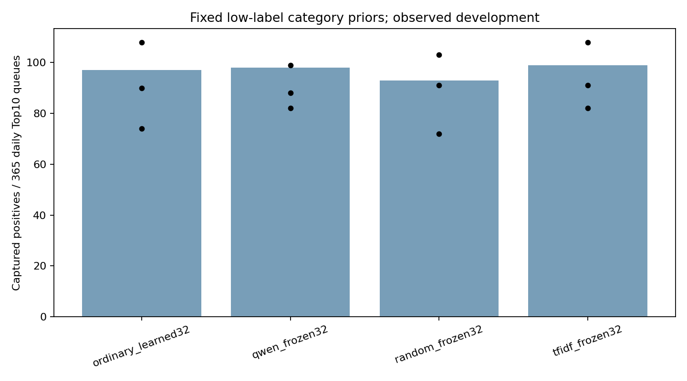

# D补充｜低标签类别先验结果

本轮未获得同时超过普通Embedding、同维随机向量及同文本TF-IDF的稳定增量证据；保留负结果，不扩大模型或继续IBM语义搜索。

原D32实例保持原状。本补充在原D开发评分产生前公开登记，再于原32实例独立核验后训练9个新实例。三种冻结向量各seed42/43/44、12轮；普通可训练Embedding直接引用原D bce三个固定模型。相同83,057可见标签、91正例、相同训练X预处理/220维历史统计、相同BCE20/样本次序/下游初始化/预算，无一致性或额外视图。未复用完整监督权重。

## 全部结果

| 表示 | 三seed TP | 集成TP | AP | P@10 | R@10 | 可训练参数 | Online名额 |
|---|---|---:|---:|---:|---:|---:|---:|
| ordinary_learned32 | 90,108,74 | 97 | 0.016622 | 0.0266 | 0.1420 | 60123 | 592 |
| qwen_frozen32 | 88,99,82 | 98 | 0.019009 | 0.0268 | 0.1435 | 56603 | 570 |
| random_frozen32 | 91,103,72 | 93 | 0.016851 | 0.0255 | 0.1362 | 56603 | 611 |
| tfidf_frozen32 | 91,108,82 | 99 | 0.017763 | 0.0271 | 0.1449 | 56603 | 568 |

Qwen只复用A已审的无channel原描述缓存，前32维L2后冻结；没有新LLM生成、编码、下载或更大模型。TF-IDF使用完全相同文本、训练类别词表的1/2gram与32维SVD；随机向量固定seed20261102。未知类别行均为零。三个冻结条件可训练参数相同，普通Embedding略多；全部非auxiliary权重从同一seed的普通冷初始化复制，冻结表在训练后仍逐字等于输入表。所有条件保留原数值/类别主干及其中MCC编码，只替换附加32维表；无预训练不等于无MCC信息。

## 新增、挤出与不确定性

| Qwen相对 | 新增正例 | 挤出正例 | 净变化 | 配对日95% | 7日区块95% |
|---|---:|---:|---:|---|---|
| qwen_vs_ordinary_learned32 | 11 | 10 | +1 | [-8.0, 10.0] | [-9.0, 11.0] |
| qwen_vs_random_frozen32 | 14 | 9 | +5 | [-4.0, 14.0] | [-4.0, 15.0] |
| qwen_vs_tfidf_frozen32 | 10 | 11 | -1 | [-9.0, 7.0] | [-8.0, 6.0] |

Qwen相对普通Embedding的同seed TP差为[-2, -9, 8]。全部条件和三个seed列出，不按结果选模板、维度或seed。逐日与区块区间是已观察开发期描述区间，未校正所有搜索；同一个mask也不代表标注策略抽样稳定性。

## 证据与边界

9个新实例各重算全部422,088个开发分数，最大误差0；原普通模型由D32独立核验绑定。Qwen/随机表从原始cache/固定RNG重建，TF-IDF从同一文本独立重算；核对冻结表、可训练容量、相同冷初始化、每轮真实91正例与学习率/步数。

MCC描述是既有类别ID的确定函数，没有新增逐交易业务事实。此处检验91可见正例时的类别先验，不能替代C2丰富业务文本研究。参数表只计下游分类器；Qwen0.6B是A中离线使用的冻结编码器，不在本轮训练参数与计时中。其历史编码成本见A的prepare记录，不能把已缓存当零成本，也不声称全系统参数量或预训练资源与随机/TF-IDF等价。现代字典与预训练模型用于历史合成数据是回顾性比较，不证明当年线上文本可得。7日标签延迟是假设，原available_at未知，真实未标注未当正常。2018已观察，2019不评测，没有新独立测试。

全部训练CPU、墙钟、评分、累计进程观察峰值与参数在low-label-prior-models.csv；补充进程资源回执从起点计量。原D bce的总进程回执缺失另在主报告披露，不影响其逐worker实测。NN字段沿用inference命名，实际包含批预测和AP/队列计算，不是纯前向或线上p99。原D bce为路径匹配也有无梯度教师计算，不是最低成本监督实现。输出只用于研究，默认仍为neural_v2_ensemble，不进入调查Agent合同。

普通参考固定为原D bce，是看到原D开发分数前公开登记的同损失比较，不能事后换成有利参考。原D还登记了标准Focal（集成TP=121）及可见标签树（TP=108），详见主报告；这是不同损失/模型的完整业务上下文。本页四条件即使超过bce，也不自动代表超过强非LLM方案；本轮不追加Focal×语义搜索。

模型正面候选条件要求：相对三个控制的集成净增均为正且7日区块描述区间下界>0，并且Qwen相对普通模型三个同seed差均>0。即使达到，仍需新的独立来源/协议后验证才能考虑升级；不声称完成普遍的LLM性能提升。

纯批预测另按固定CPU2线程逐模型完整计时，9实例重算误差0；排除AP/队列指标、权重载入及源数据读取，见low-label-prior-batch-scoring.csv与low-label-prior-batch-timing.json。黑点为各seed，柱为三个seed均值分数的集成结果。该计量不含历史统计构建及A的编码成本，也不是线上p99。
