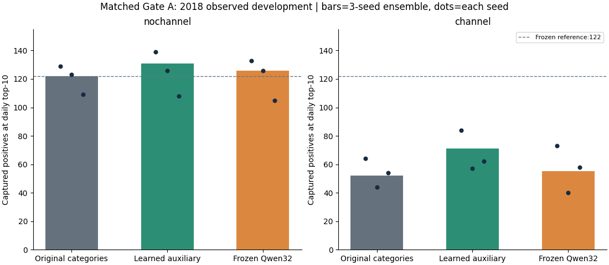
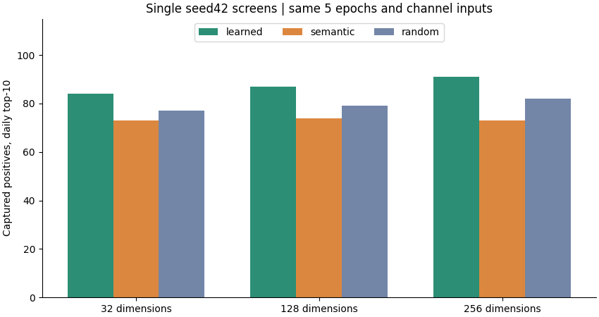

# Gate A：失败归因与有限语义研究结论

状态：Gate A已完成。主结论是在本数据和协议中停止扩大LLM模型，进入独立的充分监督历史建模。2018是反复观察的开发集，本轮不接触2019记录；没有独立未来效果声明。

## 为什么审核名额偏向Online

[原始渠道审计](CHANNEL_AUDIT.md)已复现B2的3350个Online名额与原模型745个名额。训练期Online正例773/100845，Chip正例128/617040；开发期Online正例28/50576、Chip正例564/310348。交易渠道占比接近不变，而渠道与标签的关联跨年发生强变化。此处是观测到的条件标签率变化，不能单由汇总判定完整特征条件下的概念漂移、真实欺诈机制变化或标签生成变化。

新2×3对照使用同样的12个原始数值特征、原残差核心、五轮、同三seed、训练期拟合的预处理；输入组内共同核心初始化完全相同。无channel条件同时删除类别通路与文本通路中的channel，附加向量范数及unknown策略统一。原无channel残差重训分数与原冻结分数最大差为0.0。

| 输入组 | 表示 | seed TP | 集成TP | AP | Online名额 | 总参数 | 可训练参数 |
| --- | --- | --- | --- | --- | --- | --- | --- |
| nochannel | original | [129, 123, 109] | 122 | 0.026188 | 745 | 37115 | 37115 |
| nochannel | learned | [139, 126, 108] | 131 | 0.029846 | 736 | 42683 | 42683 |
| nochannel | semantic | [133, 126, 105] | 126 | 0.028047 | 730 | 42683 | 39163 |
| channel | original | [64, 44, 54] | 52 | 0.027700 | 3070 | 37251 | 37251 |
| channel | learned | [84, 57, 62] | 71 | 0.031208 | 2885 | 48067 | 48067 |
| channel | semantic | [73, 40, 58] | 55 | 0.028526 | 3075 | 48067 | 39299 |

启用channel后，原类别编码122→52，普通附加Embedding131→71，语义Embedding126→55；Online名额分别745→3070、736→2885、730→3075。模型更容易学习训练期强相关的渠道线索，该线索在开发期的有限每日资源竞争中造成明显代价。这一失衡在没有LLM的模型中同样出现，不能把原模型与B2的全部差距归给预训练语义。

两输入组的类别通路和必要参数随channel改变；这是三seed受控建模对照，不是对每一内部机制的完全因果识别。原E1的普通/语义分支还存在向量尺度、类别分支宽度差异；本轮控制它们，不倒写原负结果，也不单独声称尺度因素的贡献已经被识别。

AP和业务主指标在此处不一致：例如原类别编码启用channel后AP略高，日Top-10捕获却122→52。因此不能改用AP挑选更好看的模型。所有分数均为未校准的排序信号，不当作欺诈概率。

## 语义表示为什么没有稳定增量

无channel时，语义相对普通附加Embedding为126−131=−5，配对日95%描述区间[-15.0, 5.0]；有channel时55−71=−16，区间[-27.0, -6.0]。三个seed均未出现语义超过同输入普通Embedding的TP增量。

| 维度 | 几何对照 | 最近邻同MCC | 按MCC留出渠道平衡准确率均值 | 三行业同渠道/不同MCC近邻准确率 |
| --- | --- | --- | --- | --- |
| 32 | qwen | 87.87% | 89.35% | 93.48% |
| 32 | random | 0.37% | 34.21% | 34.78% |
| 128 | qwen | 91.54% | 97.53% | 94.57% |
| 128 | random | 0.74% | 37.11% | 27.17% |
| 256 | qwen | 90.44% | 99.35% | 93.48% |
| 256 | random | 1.47% | 31.14% | 32.61% |

行业诊断只覆盖已核实的航空、租车、酒店三组，共92条唯一文本；排除相同MCC并匹配channel，不将有限诊断当作完整行业基准。五折训练/验证MCC无交叉。向量确实保留了行业/MCC关系，也能解码channel；这不意味着这些静态关系能预测当前数据中的欺诈标签。

对于这里只有MCC、channel短描述的输入，预训练并未新增交易行为或客户业务事实。普通类别表已能表达类别身份；预训练产业相似性与欺诈排序相关性不是一回事。不能据此否定更充分且合法可得文本上的语言知识价值。

独立词表审计还确认：2018没有训练期未见的MCC/channel联合键（有无channel两组均为0条、0正例）。本轮没有检验语言模型面向词表外新类别的迁移优势，不能把已见类别查表任务的负结果外推为所有语义场景的结论。

## 有界维度、文本和随机对照

| seed42条件 | TP | AP | Online名额 |
| --- | --- | --- | --- |
| channel-semantic-128 | 74 | 0.034068 | 2605 |
| channel-learned-128 | 87 | 0.038475 | 2413 |
| channel-random-128 | 79 | 0.037640 | 2636 |
| channel-semantic-256 | 73 | 0.034844 | 2697 |
| channel-learned-256 | 91 | 0.039044 | 2391 |
| channel-random-256 | 82 | 0.036820 | 2522 |
| channel-industry-32 | 71 | 0.031929 | 2781 |
| channel-description_shuffle-32 | 61 | 0.032165 | 2839 |
| channel-category_shuffle-32 | 67 | 0.034366 | 2712 |
| channel-random-32 | 77 | 0.037977 | 2631 |

128维语义74低于同维可训练87和随机79；256维语义73低于可训练91和随机82。行业抽象、描述打乱、类别对应打乱和随机冻结结果全部保留。这里都是同预算的单seed机制筛查，不作为稳定性或显著性证据；没有候选同时超过预先规定的普通/随机对照，故追加确认未触发，不继续增大IBM上的Embedding模型。

字典复核修正了通用行业范围端点（航空3000–3350、租车3351–3441、酒店3501起）；实际训练词表不含受修正端点影响的类别。六套已生成文本逐条比对完全不变，旧bank和旧manifest原样保留，等价回执另存，未重写向量或训练结果。

## 复核、成本与局限

独立审计重载全部28个模型，重新计算含分数ties的AP、原堆式日Top-10、训练期预处理统计和词表；检查无channel模型对channel替换不变，三seed均值及原残差重现均通过。最大重载差0.0；本轮研究检查75项通过。详见`gate-a-results.json`与`matched-results.json`。模型/分数/训练曲线和首次失败日志留在独立本地runs目录，未上传交易或权重。

28个训练实例包括18个三seed匹配模型、10个单seed筛查；不把几何诊断的渠道分类器或单元测试计入正式欺诈模型成绩。Qwen固定权重只冻结编码432条唯一类别文本，保留完整向量后切32/128/256维；原32维缓存重现误差约6e-8。训练、推理耗时及整进程峰值在每模型回执中；部分诊断和其他进程重叠，不作为隔离硬件基准。

2018多轮用于开发，配对日区间是描述性、逐比较结果，未解决选择偏差、时间依赖与多重比较。现代字典和预训练模型晚于数据年份。普通附加Embedding131略高于原模型122也不足以直接批准默认替换。

## Gate B准入

Gate A已提供渠道失衡及语义无稳定收益的可复核证据。继续使用非LLM的raw/no-channel普通可训练类别核心，冻结更充分预算后，对比历史Mean、时间衰减Mean、GRU、轻量Transformer、单跳Attention、每个架构的等参数当前特征控制、确定性历史统计及强平面/冻结基线。新邻居严格按(user_id,card_id)隔离；原点特征既有的用户级统计来源另行明示。

不将原两轮Mean的66对弱平面50直接描述成优于原冻结122。Gate C仅在后续独立数据可行性核验后启动文本实验；Gate D最后。默认检测器继续为neural_v2_ensemble。

## 原始来源与组合变化补充核验

见[SOURCE_DIAGNOSTICS.md](SOURCE_DIAGNOSTICS.md)：全部1,263,980笔选定2016–2018记录的源标签核对通过；MCC组合标准化进一步区分组成变化与单元内残差，同时列明语义字典覆盖和不可部署的审核容量上限。原A主实验成绩不变。

## 每日配额交换的只读核验

保留原模型渠道内排序、换成B2每日配额：122→42；保留原每日配额、换成B2渠道内排序：122→120，B2实际45。两条参考路径都把主要损失定位到跨渠道名额竞争，不能笼统归为每个渠道内部排序失效。该分解有交互、依赖参考路径，不是唯一因果份额，也未当作新候选优化；全矩阵与两路径增减见[SOURCE_DIAGNOSTICS.md](SOURCE_DIAGNOSTICS.md)。

## Gate B完成后的补充

[HISTORY_DECISION.md](HISTORY_DECISION.md)与[HISTORY_RESULTS.md](HISTORY_RESULTS.md)给出43实例独立核验后的结论：历史信息有明确的同参数控制增量，但Mean215对广统计196的区块区间[-5,45]包含0，尚未证明神经Mean表示独有的稳定优势。当前Attention199也不能继续概括为“没有增量”。这些后续证据不改写本报告的LLM负结果，不触发默认替换。

## 后续阶段最终核对

Gate B已完成43实例与强统计挑战：Mean215、广统计196，二者差19的七日区块区间[-5,45]，不能确认Mean的独立稳定架构优势。固定低标签语义补充也已完成：Qwen98、普通97、随机93、同文本TF-IDF99，未获得预训练独立增量。本轮停止IBM语义搜索；C1无合格新文本准入，不以更大模型补救。两个独立结论与阶段证据索引见[RESEARCH_CONCLUSIONS](RESEARCH_CONCLUSIONS.md)，不改写原研究负结果。
