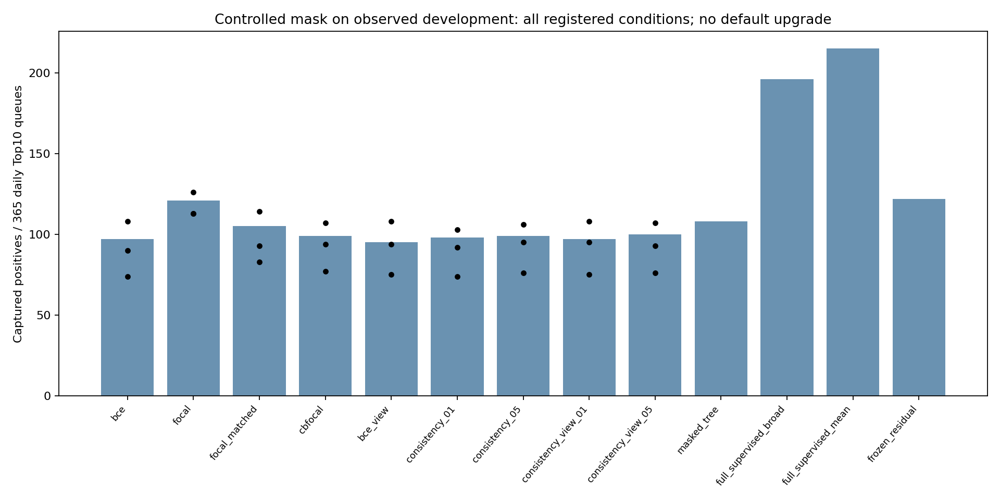
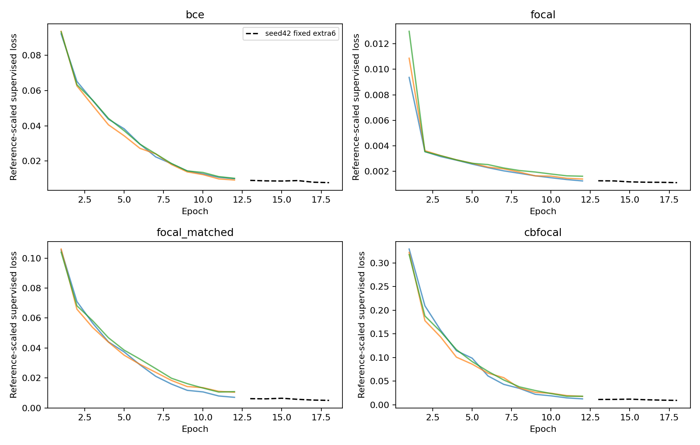
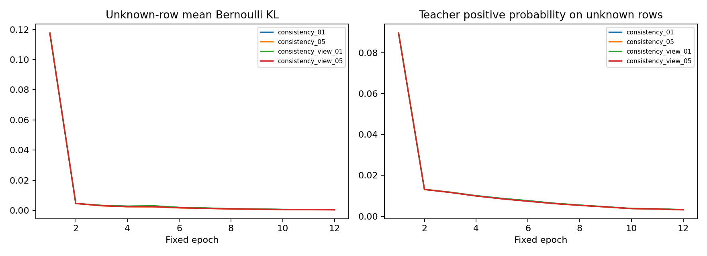

# Gate D｜既有合成数据的可控标签隐藏研究

本轮完成27个冷启动主神经模型、4个固定延训诊断和1个可见标签强树，并独立重算每实例全部422,088笔开发分数。**这是回顾性可控实验；真实标签发现时间未验证，2018不是独立测试。** 默认检测器保持`neural_v2_ensemble`，没有接入调查Agent。

## 范围与标签可得性假设

只复用既有IBM固定合成快照；沿用受限私人研究范围，不声称数据商业使用或再分发权利已经核实。源available_at为空。人为约定标签在事件后7天可用，以2017-12-31T23:59:59为训练截点，再按固定交易ID哈希暴露10%；不按标签重选mask。时间是源本地合成日历，不随意推定时区。

训练841,892笔，其中按假设可暴露标签833645笔；最终可见83057笔，正类91、负类82966；未标注758835笔。宿主在全部拟合结束后核验：隐藏部分实际含876个合成正例；这些真值没有传入训练worker，不能把未知当正常。逐年份、渠道的可见/隐藏结构见semi-label-mix.csv。

优化只加载train分区行，归一化/类别词表可使用训练池内无标签X；不将开发样本送入模型、教师或预处理更新。共享缓存的整文件指纹读取和内存映射不等于开发训练，实际worker只接收训练前缀。全部主拟合、延训和树结束并写入权重指纹后，才加载本轮开发X/y评分；既有B汇总指标此前已观察。主模型只接收-1/0/1标签向量；监督损失仅取0/1子集，一致性目标是停止梯度的软概率。范围详见TRAINING_SCOPE_NOTES.md。

## 固定输入、损失和扰动

使用B已完整监督验证的220维广覆盖历史统计网络，普通类别Embedding、宽64、两残差块、12轮、seed42/43/44、batch4096、AdamW及相同余弦。没有复用完整监督神经权重；复用的是已独立核验、不读取标签的训练X预处理及严格过去同用户卡统计。原始点特征仍保留用户级历史量。

标准Focal取α正=.25、γ=2；额外weight-matched Focal取α正=20/21，与BCE20保持20:1类别比，用于区分类别权重与难例调制。类均衡Focal用β=.9999的有效样本数，只依据可见类别数量。全局尺度在参考概率p=.5处匹配期望loss，**不声称网络初始输出恰为.5，也不声称各方法梯度/曲率相同**。

| 损失 | γ | 原负系数 | 原正系数 | 固定全局尺度 | p=.5时正logit导数幅度 | p=.5时负logit导数幅度 |
|---|---:|---:|---:|---:|---:|---:|
| bce | 0.0 | 1.000000 | 20.000000 | 1.000000 | 10.000000 | 0.500000 |
| focal | 2.0 | 0.750000 | 0.250000 | 5.448337 | 0.406292 | 1.218875 |
| focal_matched | 2.0 | 0.047619 | 0.952381 | 84.000000 | 23.862944 | 1.193147 |
| cbfocal | 2.0 | 0.893004 | 98.549985 | 4.083268 | 120.032400 | 1.087665 |

semi-loss-weights.json另保留p=.001/.01/.1/.5/.9处的正负导数。训练CSV记录实际正负损失、逐样本监督logit导数、batch归约后的导数总量、整网裁剪前范数和裁剪比例。logit导数不是整网参数梯度；标准α=.25正负比为1:3，不能将它的结果直接解释成与BCE20只有γ不同。

一致性用EMA教师衰减.99，前2轮权重0，再3轮升到预定.1或.5；不做置信阈值搜索。教师sigmoid是加权目标下的未校准模型分数，其均值不能当作真实隐藏欺诈率。所有主条件保留统一的网络Dropout.15。“无额外视图”仍有该模型噪声；额外视图只对内部上下文激活做.1 Dropout，使用独立RNG，不改交易金额、类别、时间或邻居身份。bce_view的λ=0控制用于区分普通正则化和一致性增量。

为匹配计算路径，λ=0条件也计算无梯度教师前向；这是计算路径匹配的监督对照，并非最高效率的监督训练实现。固定强树只拟合可见标签，另提供业务备选，容量/类别权重与神经网络不同，不作单一因素因果对照。

此处原32实例不混入预训练语义。PRD要求的有无预训练对照另在原D开发评分前公开登记为固定9实例补充，见LOW_LABEL_PRIOR_PROTOCOL.md；只复用A已审核MCC类别文本和缓存，不代表C2新业务文本准入。本报告只对应原32实例，不预写补充结果，也不复用完整监督权重。

## 业务成绩

| 条件 | 三seed各自TP | 集成TP | P@10 | R@10 | AP | Online名额 |
|---|---|---:|---:|---:|---:|---:|
| bce | 90,108,74 | 97 | 0.0266 | 0.1420 | 0.016622 | 592 |
| focal | 113,126,113 | 121 | 0.0332 | 0.1772 | 0.032626 | 621 |
| focal_matched | 93,114,83 | 105 | 0.0288 | 0.1537 | 0.017956 | 685 |
| cbfocal | 94,107,77 | 99 | 0.0271 | 0.1449 | 0.015876 | 673 |
| bce_view | 94,108,75 | 95 | 0.0260 | 0.1391 | 0.017186 | 596 |
| consistency_01 | 92,103,74 | 98 | 0.0268 | 0.1435 | 0.016641 | 591 |
| consistency_05 | 95,106,76 | 99 | 0.0271 | 0.1449 | 0.017257 | 606 |
| consistency_view_01 | 95,108,75 | 97 | 0.0266 | 0.1420 | 0.017325 | 601 |
| consistency_view_05 | 93,107,76 | 100 | 0.0274 | 0.1464 | 0.017883 | 615 |
| masked_tree | 上下文/单树 | 108 | 0.0296 | 0.1581 | 0.014787 | 636 |
| full_supervised_broad | 上下文/单树 | 196 | 0.0537 | 0.2870 | 0.089608 | 561 |
| full_supervised_mean | 上下文/单树 | 215 | 0.0589 | 0.3148 | 0.090584 | 615 |
| frozen_residual | 上下文/单树 | 122 | 0.0334 | 0.1786 | 0.026188 | 745 |

主指标仍是全渠道合计每日10名额。表中full_supervised是此前B的完整监督上下文，标签暴露和计算路径不同；masked_tree只有固定seed42，不能拿它冒充三seed稳定性。完整分渠道AP、名额、TP/FP、Precision/Recall在semi-channels.csv。

## 新增、挤出与不确定性

| 对照差：候选−基线 | 新增正例 | 挤出正例 | 净变化 | 配对日95% | 7日区块95% |
|---|---:|---:|---:|---|---|
| focal_vs_bce | 43 | 19 | +24 | [9.0, 40.0] | [7.0, 41.0] |
| focal_matched_vs_bce | 20 | 12 | +8 | [-3.0, 20.0] | [-1.0, 17.0] |
| cbfocal_vs_bce | 20 | 18 | +2 | [-11.0, 14.0] | [-8.0, 12.0] |
| bce_view_vs_bce | 4 | 6 | -2 | [-8.0, 3.0] | [-7.0, 4.0] |
| consistency_01_vs_bce | 3 | 2 | +1 | [-3.0, 5.0] | [-3.0, 5.0] |
| consistency_05_vs_bce | 6 | 4 | +2 | [-5.0, 8.0] | [-4.0, 7.0] |
| consistency_view_01_vs_bce | 4 | 4 | +0 | [-6.0, 5.0] | [-6.0, 6.0] |
| consistency_view_05_vs_bce | 8 | 5 | +3 | [-4.0, 10.0] | [-5.0, 12.0] |
| focal_matched_vs_focal | 21 | 37 | -16 | [-32.0, -2.0] | [-33.0, 0.0] |
| cbfocal_vs_focal_matched | 5 | 11 | -6 | [-14.0, 1.0] | [-13.0, 1.0] |
| masked_tree_vs_bce | 63 | 52 | +11 | [-9.0, 31.0] | [-8.0, 30.0] |
| consistency_view_01_vs_bce_view | 3 | 1 | +2 | [0.0, 5.0] | [0.0, 5.0] |
| consistency_view_05_vs_bce_view | 6 | 1 | +5 | [1.0, 10.0] | [1.0, 10.0] |
| consistency_view_01_vs_consistency_01 | 5 | 6 | -1 | [-7.0, 5.0] | [-7.0, 5.0] |
| consistency_view_05_vs_consistency_05 | 6 | 5 | +1 | [-6.0, 9.0] | [-6.0, 10.0] |

原冻结、全监督Mean和全监督广统计的全部比较保留在semi-comparisons.json。配对日bootstrap固定2000次，7日循环区块固定5000次；都是反复开发数据上的逐比较描述区间，未校正全部搜索。三个seed共享同一个mask，只检验初始化稳定性，不能代表标签获取策略的抽样不确定性。

## 一次有界收敛诊断

四个未增强损失的seed42各自从低标签12轮检查点继续6轮，固定最终学习率5e-5。它们全部在打开本轮开发评分之前完成，不按较好的开发指标挑选延训对象。原12轮权重与主结果保留；18轮单seed诊断不替换12轮三seed主结果。

| 损失（固定seed42） | 12轮TP | 18轮TP | 净变化 | 12轮AP | 18轮AP |
|---|---:|---:|---:|---:|---:|
| bce | 90 | 91 | +1 | 0.015687 | 0.015334 |
| focal | 113 | 106 | -7 | 0.027406 | 0.024521 |
| focal_matched | 93 | 94 | +1 | 0.014057 | 0.014116 |
| cbfocal | 94 | 94 | +0 | 0.013311 | 0.014152 |

曲线用于诊断数值稳定和有限预算趋势。延训仍下降不等于已经全局收敛；业务分数低也不能直接证明损失无效。本轮到预定18轮诊断结束，不继续搜索α、β、λ或更多初始化。

## 技术判断与边界

四个一致性条件相对bce的点估计净变化为{'consistency_01': 1, 'consistency_05': 2, 'consistency_view_01': 0, 'consistency_view_05': 3}。其中['consistency_01', 'consistency_05', 'consistency_view_05']为正差，须结合逐seed、额外视图基线和配对区间判断；不把点估计当稳定采用证据。

权重匹配Focal相对bce的净变化为+8；它相对常规Focal的净变化为-16。这两项对照与实际梯度/曲线共同阅读，避免把类别比变化全算作Focal机制效果。额外视图、EMA和λ的结果也分别保留，不只选有利配置。

本轮不支持真实未标注数据的正负比例假定、不证明真实标签延迟下效果、不提供新独立外部验证。现有观察只能作为方法取舍证据；即使点估计改善，也不升级默认检测器。

## 核验与成本

独立重建日期资格和哈希mask；核对可见类别数、冷启动状态、每轮真实样本/更新数/学习率/λ、损失系数和延训来源；31个神经实例及1个树各重算全部开发分数。神经最大误差0，树误差0。因果历史与220维特征的全量源重建继承B已审的**相同字节**，没有把继承证据冒称第二次独立特征重建。

| 进程 | 实际CPU秒（线程合计） | 整进程峰值GiB |
|---|---:|---:|
| training | 总量未记录；见逐模型实测 | 总峰值未记录；见逐模型观察 |
| audit | 253.98 | 4.30 |

semi-models.csv给出各条件全部seed的训练循环CPU/墙钟、评分CPU/墙钟、参数及模型结束时观察到的累计进程峰值；semi-training-curves.csv保留逐轮资源。CPU为线程合计，累计进程峰值含数据/先前模型，不是隔离单模型内存。NN字段仍沿用inference命名，但实际计时包括批预测及AP/队列指标计算，不能冒充纯前向延迟。原训练CLI在全部评分成功后因资源父目录不存在而写回执失败；原模型/分数/曲线完整保留，未重训。总进程CPU与最终峰值不能事后恢复，明确留空；资源回执只另列逐worker和评分计量求和的下界，不冒充完整进程测量。审计阶段从起点完整计量。D复用B已构建统计矩阵，构建代价没有变成零；当前批量计时也不代表线上单请求p99。GPU/付费模型调用均为0。

本地回归1051项，失败0、错误0；XML SHA256 `be57fbf0f3d1e977466bae5ce0462d51ea1e78126b1f60a12dafa2f3ce4eaefd`。不冒充GitHub共享CI通过。来源协议、失败日志和复现命令分别见GATE_D_PROTOCOL.md、FAILURES.md与REPRODUCE.md。

方法定义参考：[Focal Loss](https://arxiv.org/abs/1708.02002)、[Class-Balanced Loss](https://arxiv.org/abs/1901.05555)、[Mean Teacher](https://arxiv.org/abs/1703.01780)。本轮是明确声明的表格数据受控变体，不声称复现这些论文的视觉任务成绩。

## D成本补充核验

纯批评分另行只读复核：从已加载权重出发，包括模型输入转换与预测，排除AP/队列指标、源数据读取和权重载入；固定CPU2线程，每模型完整422,088笔只取一次，不挑最快重复值。原32实例全部通过，重算误差0。见semi-batch-scoring.csv及semi-batch-timing.json。它不包含统计特征重建，也不是线上p99或隔离主机测量。
