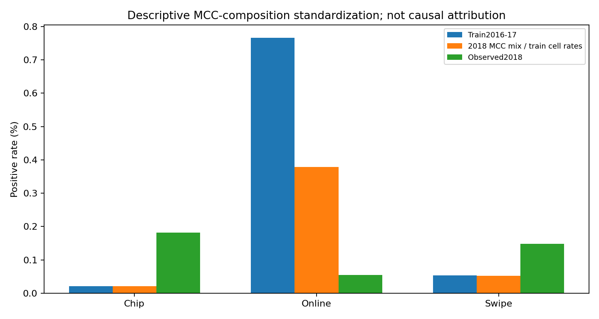
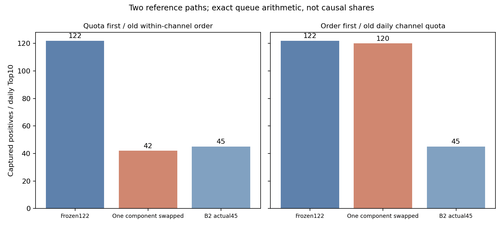

# Gate A补充：原始标签、MCC组合、文本覆盖与容量

这些是不新增欺诈模型训练的补充诊断，在A主实验之后完成。原28个匹配/筛查实例、原指标、向量和失败记录保持原样。它们补强和限定归因，不是新的候选选择或独立测试。

## 原始CSV与提取结果的一致性

先对128笔按年份、渠道、标签分层的交易，独立核对用户、用户卡、时间、渠道、MCC、商户、金额和标签，128笔全部一致。随后对全部1,263,980笔选定2016–2018记录，按物理source_row回查原始压缩CSV，逐笔核对年份、渠道与标签，全部一致。

因此，2017 Online/Swipe正例均为0这一现象，也存在于这些记录的原始标签中，不能直接归咎于本轮提取时把标签弄错。核对不证明原模拟器机制正确，也不独立证明没有遗漏任何应入选的源记录。非选定行只按字节跳过；未解码或评测2019记录。

来源归档SHA256：`e9f589a0958f40d60f81b1a2e8428db86e00c05755caf44fb055827976c0efa2`。首次128笔审计的卡号命名空间比较错误及修正记录见`FAILURES.md`，未改变数据或模型。

## 渠道占比稳定，不等于渠道内部完全没有组合变化

| 渠道 | 训练正率 | 按开发MCC组合标准化 | 开发正率 | MCC组合TV | 组合分量/百分点 | 单元内残差/百分点 |
|---|---:|---:|---:|---:|---:|---:|
| Chip Transaction | 0.020744% | 0.020938% | 0.181731% | 0.005465 | 0.000194 | 0.160794 |
| Online Transaction | 0.766523% | 0.378341% | 0.055362% | 0.013701 | -0.388182 | -0.322979 |
| Swipe Transaction | 0.053223% | 0.052012% | 0.148780% | 0.012561 | -0.001211 | 0.096768 |

固定训练期各MCC×渠道单元的经验正率，以开发期MCC构成重新加权：

`总正率变化 = (开发MCC权重×训练单元正率 − 训练正率) + (开发正率 − 开发MCC权重×训练单元正率)`。

Online从0.766523%下降到0.055362%；仅把MCC组合换成开发期构成，标准化正率已降到0.378341%。组合项为−0.388182个百分点，约占总下降的54.6%；同MCC单元内的剩余变化为−0.322979个百分点。虽然MCC组合总变差只有0.013701，少量高训练正率单元的权重变化仍可产生较大影响。

**这是一种经验率的算术标准化，不是因果份额。** 稀疏单元正率的估计不稳定，残差仍混有其他特征、主体构成、时间和标签机制变化。不能把这54.6%解释成已经识别的真实欺诈机制，也不能根据汇总正率就宣称完整特征条件下的concept drift。

## 交换配额与渠道内排序：直接核验失衡环节

对每个模型和每一天，分别固定渠道名额与渠道内排序，交换这两个队列构件；不重新训练，不根据评测标签挑配额。以下两列交换结果均保持每天总计10个名额。

| 比较/新模型相对旧模型 | 旧TP | 新TP | 旧排序+新配额 | 新排序+旧配额 | 净变化 | 交互项 |
|---|---:|---:|---:|---:|---:|---:|
| strong_tree_vs_frozen_residual | 122 | 109 | 123 | 111 | -13 | -3 |
| B0_vs_frozen_residual | 122 | 48 | 51 | 120 | -74 | -1 |
| B1_vs_frozen_residual | 122 | 59 | 51 | 124 | -63 | +6 |
| B2_vs_frozen_residual | 122 | 45 | 42 | 120 | -77 | +5 |
| B3_vs_frozen_residual | 122 | 53 | 50 | 117 | -69 | +8 |
| B3_shuffled_vs_frozen_residual | 122 | 55 | 53 | 125 | -67 | -1 |
| mean_vs_frozen_residual | 122 | 66 | 49 | 120 | -56 | +19 |
| attention_vs_frozen_residual | 122 | 51 | 54 | 103 | -71 | +16 |
| channel-original_vs_nochannel-original | 122 | 52 | 49 | 124 | -70 | +1 |
| channel-learned_vs_nochannel-learned | 131 | 71 | 67 | 131 | -60 | +4 |
| channel-semantic_vs_nochannel-semantic | 126 | 55 | 56 | 124 | -71 | +1 |
| nochannel-semantic_vs_nochannel-learned | 131 | 126 | 133 | 128 | -5 | -4 |
| channel-semantic_vs_channel-learned | 71 | 55 | 59 | 63 | -16 | +4 |

B2的两条路径是：

- 原模型122 → 保留原渠道内排序、改用B2每日配额42 → 再换B2渠道内排序45。
- 原模型122 → 保留原每日配额、改用B2渠道内排序120 → 再换B2配额45。

两条路径都显示，此处主要工程损失发生在跨渠道分数竞争所形成的审核名额分配上，而不是B2在每个渠道内部都无法排序。匹配2×3矩阵的channel开启/关闭也呈现同样的现象，不能把失衡直接归为“LLM语义质量差”。

**分解依赖参考路径，具有交互项，不是唯一因果贡献份额。** 交换结果是对既有开发分数的只读核验，不作为新候选、配额优化或模型发布方案。A阶段表中的mean/attention是旧两轮模型，不与B阶段12轮新模型混用。完整两路径增减项见`source-queue-attribution.json`，其channel_profiles还保存各模型在各渠道全部交易上的AP和全局每日队列内TP/名额；没有把每渠道另给10名额当主指标。

### 分渠道AP与总体业务捕获为何不同

| 模型/条件 | Chip内部AP | Online内部AP | Swipe内部AP |
|---|---:|---:|---:|
| frozen_residual | 0.024751 | 0.027523 | 0.069592 |
| strong_tree | 0.013557 | 0.003127 | 0.007828 |
| B0 | 0.018593 | 0.538091 | 0.025978 |
| B1 | 0.022316 | 0.579324 | 0.015390 |
| B2 | 0.018707 | 0.569334 | 0.035341 |
| B3 | 0.018546 | 0.546256 | 0.025249 |
| B3_shuffled | 0.018625 | 0.531503 | 0.028628 |
| mean | 0.024432 | 0.728662 | 0.032774 |
| attention | 0.018750 | 0.686601 | 0.013589 |
| nochannel-original | 0.024751 | 0.027523 | 0.069592 |
| channel-original | 0.018880 | 0.430284 | 0.021578 |
| nochannel-learned | 0.026956 | 0.037443 | 0.092247 |
| channel-learned | 0.024862 | 0.463599 | 0.016764 |
| nochannel-semantic | 0.026063 | 0.031401 | 0.086085 |
| channel-semantic | 0.019615 | 0.448547 | 0.025450 |

B2的Online内部AP约0.569334，普通附加Embedding的B1约0.579324，数值上远高于原模型的0.027523；但B2仍把3350名额分给Online，只有25个Online正例，留下3325个评测负例，整体捕获45。这不是矛盾：在一个渠道内部能排序，不代表不同渠道的分数可以直接形成有效的全局名额竞争。

这也不意味着“channel没有信息”。匹配模型加channel后，Online内部排序可提升，而总体每日容量利用变差；普通附加Embedding也有同一现象。不能把Online高AP当作LLM独有价值，也不能把无channel在此开发期较好外推为所有数据都应删除channel。各渠道基准正率不同、Online只有28个正例，跨渠道AP值不作等难度比较。

## 语义覆盖的边界

当前109个MCC中107个有核实字典描述。5912存在本次允许来源的码表歧义，5921未纳入允许字典，保留unknown_description，没有猜写。2018这两码合计28,847笔、44个正例，分别约占交易6.83%、正例6.44%。这不是训练期未见类别：底层普通类别编码仍能识别它们；缺少的是可靠的附加文字含义。当前结果不能单独识别缺失描述造成的性能影响。

对无channel的107个已知类别，固定K8聚类；对32个航空、租车、酒店品牌MCC，固定K3、seed731、n_init20，与行业标签比较：

| 维度 | Qwen ARI/NMI | 随机 ARI/NMI |
|---|---:|---:|
| 32 | 0.892305 / 0.896072 | 0.018264 / 0.073797 |
| 128 | 0.793007 / 0.833268 | 0.092423 / 0.147981 |
| 256 | 0.793007 / 0.833268 | -0.010257 / 0.049514 |

Qwen向量有明显产业结构，随机向量没有。这仅确认有限模板的语义结构可解释，不是完整行业评测，也不证明预训练知识对欺诈有独立价值。诊断没有使用欺诈标签，未把这些聚类器计入28个欺诈训练实例；完整簇中心近邻见`source-clusters.json`。

## 审核容量仍有多少空间

2018有683个正例，174天没有正例；5天正例超过10个，单日最多16个。即使预先知道答案，固定每日10名额最多捕获666个，而非683个。因此现有模型与容量上限之间仍有空间；不能把负结果解释成审核容量已经完全饱和。

这个666使用评测标签计算，只是不可部署的数学上限，不是新主指标、训练目标或候选基线。原主指标仍是每日Top-10累计真实捕获数。

## 复现和证据

命令见`REPRODUCE.md`。六份`source-*.json`保留原报告字节，`source-diagnostics.json`记录其SHA256。没有新增交易或身份上传，没有训练新LLM，没有改写原Gate A成绩。
