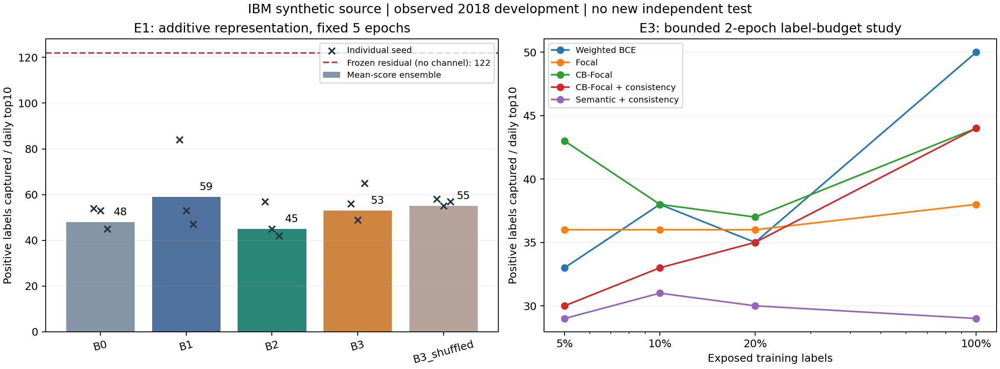

# Detection V2：研究交付与采用决定

2026-11-01。已完成本轮准入的E1、独立轻量历史E2、短预算半监督E3，以及可选候选告警演示。**不建议替换现有默认检测器。** E4未达到准入条件，不组合堆叠语义、图和一致性损失，也不继续下载更大编码器。

正式工作位于独立worktree `semantic-detector-v2`，分支 `codex/llm-semantic-detector`。没有修改共享Agent、原README、原依赖清单、旧模型或历史研究包。

## 实际结论

- **语义：未显示额外收益。** 同训练期、数值与原类别分支、5轮、3seed，普通附加类别嵌入捕获59，冻结Qwen32维45，加投影53，打乱语义对应55。B2相对B1净-14，配对日重采样区间[-26,-2]；B3净-6，区间[-17,5]。这些是开发期逐项描述，不是独立显著性结论。
- **历史：简单池化出现有限正向证据。** 同2轮、全部标签和B1信息，匹配普通模型50，最近6笔mean66，单跳注意力51；mean净+16，区间[2,32]。历史分支也增加参数，不能把全部差异单独归给边结构；注意力没有超过更简单的mean。
- **半监督：本预算内未改善。** 5%/10%/20%标签下，CB-Focal捕获43/38/37，一致性30/33/35。100%标签下两者均44，独立核验确认没有无标签样本时该项分数逐seed完全相同。两轮研究不能排除其他训练预算的收益。
- **业务采用：继续原模型。** 原冻结无渠道残差在同2018容量下捕获122，强匹配输入树109。新研究没有支持升级的证据；AP提高不能替换每天10笔的主指标。

所有数字来自IBM合成源的**2018已观察开发数据**，不重跑2019、不称新独立测试、不换算实际损失或分析师工时。E2是轻量历史研究，未声称复现完整TGAT。

完整[实验报告](RESULTS.md)、[机器汇总](results.json)、[复现步骤](REPRODUCE.md)、[技术与面试说明](INTERVIEW_TECHNICAL.md)、[Gate0与设计修正](GATE0.md)、[原始PRD](PRD.md)。



柱为平均分数集成，叉号为单seed捕获；集成捕获不是三个捕获数的算术平均。右图CB-Focal与一致性在100%标签下重合是负对照结果。

## 范围与验收

| 门槛 | 实际交付 | 状态与边界 |
|---|---|---|
| Gate0 | 109种训练MCC/3渠道审计、官方词典、Qwen固定版本、来源/时间/权限合同 | 回顾性研究可用；5912冲突、5921缺失回退unknown，线上可得性未证实 |
| Gate1 | 冻结编码器缓存、原类别保留的附加表示、15次正式E1训练、独立排名/AP与重载 | 工程与研究完成；语义效果为负，不准入语义组合 |
| Gate2 | 6次轻量历史运行、5043232条过去边核验；60次标签预算运行与独立审计 | 有界研究完成；不做完整TGAT、LLM图或E4，不将机制测试当效果 |
| Gate3 | 核心六字段队列、独立release ID、三seed全量重算、2案例通用调查/SQL/版本绑定 | 可选通用接入完成，默认未变；特化欺诈MCP仍只接受旧ID，未改共享合同 |

特化欺诈MCP扩展需要独立集成PR及新旧回归，当前分支没有绕过其验证器或冒用旧ID。当前交付证明通用调查消费者能保留并使用新版本，不声称已打通该特化分支。没有升级请求，也没有默认发布。

## 核验与成本

正式81个模型运行：E1十五个、E2六个、E3六十个。所有固定seed与负结果均保存；未挑最好seed。独立核验包括：SQLite日top10、手工阈值组AP、训练边逐条检查和96个目标邻域重建、全部训练mask、12份实际冻结语义表、100%标签负对照及模型重载。

最终相关回归 **210通过、0失败、0跳过**，含MCP、多来源、Harness、Memory、旧神经模型、审阅与真实HTTP进程恢复。有1项既有Starlette弃用提示。并发期间曾有203通过/1个恢复测试失败，单独重测通过；最终停止训练后全批210通过。首次失败和日志保留，未定位其根因，也未为此修改共享服务。

原残差、强树、2019最终包和原演示包共217个文件，前后哈希全部一致。新付费API调用0、GPU租用0、源交易上传0。Qwen只对272种唯一文本编码；检测推理使用缓存向量及小网络，不逐笔运行大模型。

Qwen下载约1.2GB，首次末尾截断后拒绝加载，经官方LFS SHA核验补全。图数组约60.6MB，训练建图27.8秒，推理采样器构建42.0秒；历史模型每seed两轮约166–202秒，整进程峰值约2.47GiB。完整每模型数据见JSON。检测器参数数不含离线0.6B编码器；并发和本机负载使这些耗时不能作为隔离性能基准。

**执行偏差保留：** E1/E3各自协议冻结后并行，未严格遵循PRD逐阶段串行顺序；独立历史E2在正式E1及独立核验后启动。初轮replacement实现不满足附加特征要求，已另存为先导，停止相关半监督批次，再冻结additive-v2正式重跑。旧缓存v1未改写；v2身份修正通过等值向量审计另存。所有偏差不混入正式模型成绩，不伪造事前协议或删除失败。

## 打开已核验的候选演示

在新worktree根目录运行；本机复用原环境，无需重训：

```powershell
Set-ExecutionPolicy -Scope Process -ExecutionPolicy RemoteSigned
& ..\financial-report-agent\scripts\run_project.ps1 -m app.cli.workbench --directory runs/semantic-challenger-demo-v1/service --catalog runs/semantic-challenger-demo-v1/catalog.json
```

访问 `http://127.0.0.1:8765`，本地令牌位于该service目录的auth.token，不是模型API Key。2份报告仍待审阅，确认过程为脚本模拟，未自动接受报告或批准规则。新来源为 `semantic-challenger-b3-3dc8ee2d4e38`；并非默认模型，也不是推荐升级的胜出方案。

## 本机材料

- `runs/semantic-e1-additive-v2/`、`runs/semantic-e2-history-v1/`、`runs/semantic-e3-additive-v2/`：正式协议、曲线、模型、分数和完整报告。
- `runs/semantic-prepare-v2/embedding-cache/`：本轮实际训练缓存；`runs/semantic-cache-attested-v2/`：向量不变的新身份格式审计。
- `runs/semantic-challenger-demo-v1/`：无标签全量重算、日名单、源案例、通用调查报告和SQL回执。
- `runs/semantic-detection-sources/`：官方来源、下载/测试失败记录、三类独立核验、最终JUnit及原材料保护证明。
- `runs/semantic-e1-v1/`与`runs/semantic-e3-v1/`：设计修正前的先导及中止记录，不作正式结果。

大文件和模型保留在此worktree的Git忽略目录，Git仅保存代码、汇总和审计说明。源数据依赖原研究快照；不宣称任意电脑无需数据即可复现全部研究。
